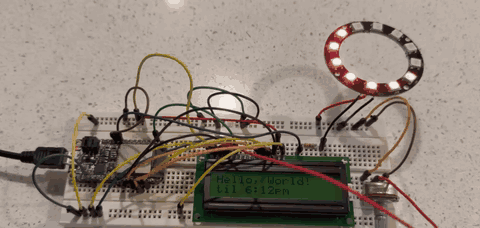
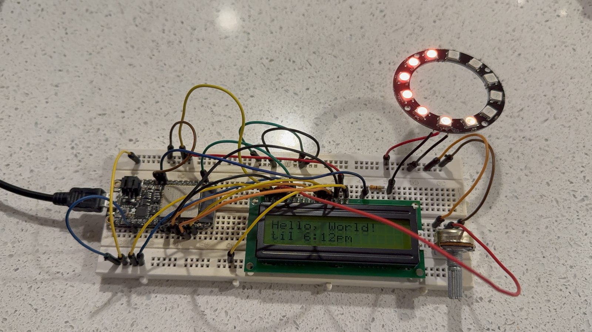

<p align="center">
  <a href="https://bzzy.ca">
    <picture>
      <source media="(prefers-color-scheme: dark)" srcset="docs/brand/bzzy-lockup-dark.svg">
      
    </picture>
  </a>
</p>

<p align="center">
  <a href="https://github.com/vancityactivist/bzzy/actions/workflows/app.yml"></a>
  <a href="https://github.com/vancityactivist/bzzy/actions/workflows/firmware.yml"></a>
  <a href="https://github.com/vancityactivist/bzzy/releases"></a>
  <a href="https://bzzy.ca"></a>
  <a href="LICENSE.md"></a>
</p>

# bzzy

A homebrew desk busy light: a small screen that shows GIFs, a ring of light around it, and a status (Free, Busy, Do not disturb, Away) set from your phone, your calendar, or the button on top of the device. It clips to a monitor and is powered over USB-C.

The companion app runs at **[bzzy.ca](https://bzzy.ca)**.

## What's in the repo

| Folder | What it is |
|---|---|
| [app/](app/README.md) | The companion app: Next.js on Vercel, Postgres on Neon (Drizzle), GIFs in Vercel Blob, sign-in with GitHub or a passkey |
| [firmware/](firmware/) | PlatformIO firmware for ESP32-S3 boards: the Waveshare development board today, the bzzy main board next, plus cheap test builds |
| [hardware/](hardware/README.md) | The custom main board (in design), and the DIY build: LED ring board (KiCad, rev D, not built yet) and printed case (OpenSCAD) |
| [docs/](docs/README.md) | All the docs, indexed. Start with [docs/plan.md](docs/plan.md) for what's next |
| [docs/protocol.md](docs/protocol.md) | How the device and the app talk |
| [docs/ota.md](docs/ota.md) | Firmware updates over Wi-Fi |
| [docs/domains.md](docs/domains.md) | bzzy.ca, the redirect domains, DNS and email records |

## How it fits together

```
 ICS calendar feed ──▶ companion app (Next.js) ◀── phone / laptop
                         ▲          ▲
   firmware releases ────┘          │ device polls over HTTPS (outbound only)
   (GitHub Releases)                │
                               bzzy device ◀── button
```

The device never needs anything to connect *to* it, so it works on guest Wi-Fi that isolates devices. It saves the last state it received, so it keeps following your calendar and button presses if Wi-Fi or the app goes away. See [docs/protocol.md](docs/protocol.md).

## The app

- **Status:** set Free, Busy, Do not disturb or Away, or leave it on automatic. A live preview shows exactly what the light's screen and ring look like right now.
- **Show now:** put a GIF or a short message on the light straight away. It takes over the whole screen until you clear it.
- **Calendar:** add an ICS link (Settings → Calendars). Meetings make you Busy, out of office makes you Away, and a manual status still wins.
- **GIFs:** upload your own or paste a GIPHY or Tenor link, then pick one per status on the Devices page. Long GIFs are thinned out to fit the device.
- **Devices:** add a light by scanning the QR code on its screen (or typing its code at [bzzy.ca/pair](https://bzzy.ca/pair)), choose its GIFs, and see its firmware version and updates.
- **Teams:** everyone gets a personal team. Devices, calendars and GIFs belong to a team.
- **Admin:** a sign-up and usage overview for admin users.

Signed out, the home page is a landing page about bzzy. The app has no cron jobs: calendars refresh when a device polls (every 20 seconds) or a page loads. See [app/README.md](app/README.md) to run it locally.

## Where it's at

Done:

1. Breadboard prototype firmware
2. Companion app with sign-in, teams, status, device API, GIFs, show now and the live preview
3. Calendar sync from an ICS link
4. DIY build designed: a custom LED ring board (rev D, drawn from a measured Waveshare board) for the Waveshare board, and a black case with a frosted light border, button cap and bzzy wordmark ([hardware/](hardware/README.md)). Not built or tested yet
5. Signed firmware updates over Wi-Fi from GitHub Releases ([docs/ota.md](docs/ota.md))
6. Setup on the light's own screen: QR codes for Wi-Fi, then pairing with the app

7. Proof of life on a test build (see the build log below)
8. Spec for the custom main board ([docs/hardware/main-board.md](docs/hardware/main-board.md))

Next (the full list is in [docs/plan.md](docs/plan.md)):

1. **Waveshare test**, with a few LEDs on GPIO17, and caliper the screen glass.
2. **Screen bench test**: the main board's ER-TFT1.69-4 panel on an ESP32-S3 DevKit ([docs/s3-devkit-bench-test.md](docs/s3-devkit-bench-test.md)).
3. **Main board in KiCad**, schematic then layout, and the case redesigned to match.
4. **Prototypes** from JLCPCB (5 to 10), including a Wi-Fi range test. Expect a second spin.
5. **ICES-003** emissions test: quotes, a pre-scan, the test.
6. **First batch** of built bzzys.

### Later

- **Pre-built lights.** Sell assembled and tested bzzys in small batches, built on the main board. The landing page already says they're coming. The ordering spec is in draft PR #81.
- **DIY side stream.** Keep the Waveshare + ring board + printed case build working for people building their own: order and test a rev D ring, which is drawn from a measured Waveshare board and has the rev C review fixes ([hardware/](hardware/README.md)).
- **Landing page photos.** The signed-out home page (`app/src/components/landing.tsx`) uses a concept picture and illustrations. Swap them for photos of a real bzzy once one is built.

## Build log

### 2026-11-15: proof of life

<p align="center">
  
</p>

The first bzzy to run on real hardware. It's the cheap test build, not the real thing yet: a classic ESP32 (an Adafruit HUZZAH32 Feather) on a breadboard with a 16x2 character LCD and a 12-LED WS2812 ring ([docs/esp32-test-build.md](docs/esp32-test-build.md)).

It joined Wi-Fi, paired with the live app at bzzy.ca, and then did what it was told: a *Show now* message sent from the app came up on the LCD as "Hello, World! / til 6:12pm", with the ring chasing red. Everything between the phone and the light (sign-in, pairing, the device API, polling over HTTPS, show now and its ring effect) worked end to end.

<p align="center">
  <a href="docs/images/proof-of-life-2026-11-15.jpg"></a>
</p>

Next up is the same firmware on the Waveshare touch board inside the custom ring and case.

### 2026-11-19: one board instead of two

Change of plan. To sell built bzzys in Canada, anything with a radio needs ISED certification, and the Waveshare board doesn't have it: its ESP32-S3 is a bare chip with its own antenna, not a certified module. Certifying it ourselves would cost thousands more, every time the board changed.

So the sellable bzzy gets **its own board**: Espressif's pre-certified ESP32-S3-WROOM-1U module with a small antenna stuck inside the case, the same 1.69" 240x280 touch screen bought bare (BuyDisplay ER-TFT1.69-4), USB-C, a clock and the ring of 16 LEDs, all on one PCB. Because the radio certification comes with the module, bzzy itself only needs an ICES-003 emissions test. It's the same chip, memory and pins as the Waveshare board, so the firmware only needs a new build target. The spec is in [docs/hardware/main-board.md](docs/hardware/main-board.md).

The DIY build doesn't go away. Anyone building their own can still buy a Waveshare board, order the LED ring board and get the case printed; that stays as a side stream, so the barrier to building one stays low. The ring board (rev D) hasn't been ordered or tested yet, and the main board reuses its outline, corner holes and button, so the case fits both. The Waveshare board is also the development board. Screen samples, FPC breakouts and two ESP32-S3 DevKits are on order for a bench test on Saturday. The plan from here is in [docs/plan.md](docs/plan.md).

## Hardware

The product is the **bzzy main board** (in design): one custom board with an ESP32-S3-WROOM-1U module, the 1.69" touch screen and 16 LEDs, in a printed black case with a frosted border that glows in the status colour. See [docs/hardware/main-board.md](docs/hardware/main-board.md) and [hardware/](hardware/README.md).

Until it exists, the **Waveshare ESP32-S3-Touch-LCD-1.69** is the development board. It has the same chip, memory and pins, but no radio certification, so it's for building your own, not for selling. The non-touch board and a plain ESP32 still build, for testing. The parts below are for a breadboard build on the Waveshare board.

| Part | Part number to search | Notes |
|---|---|---|
| Main board (touch) | **Waveshare ESP32-S3-Touch-LCD-1.69**, SKU **27350** | ESP32-S3R8 (8 MB PSRAM), 16 MB flash, 1.69" 240×280 ST7789V2, CST816T touch, PCF85063 RTC, QMI8658 IMU, buzzer, USB-C |
| Main board (no touch, alternative) | Waveshare ESP32-S3-LCD-1.69, SKU 27932 | Same board without touch |
| LED ring (prototype) | WS2812B 12-LED ring, 50 mm (or Adafruit NeoPixel Ring 12, #1643) | |
| Push button (optional) | Any momentary switch | To try the top button: between GPIO18 and GND |
| Resistor | 330 Ω, 1/4 W | In series on the LED data line |
| Capacitor | 470 µF, 10 V or higher, electrolytic | Across LED 5 V / GND, near the LEDs |
| RTC backup cell (optional) | Rechargeable ML1220 with an SH1.0 2-pin lead | Keeps the clock through power cuts. Without it, the clock comes back from NTP once Wi-Fi does |

**Wiring (touch board):** LED data to **GPIO17**, LED 5 V to the board's 5 V pin, GND to GND. The free pins on this board are 2, 3, 17 and 18. Avoid 3, which is a strapping pin. LED current is capped at 250 mA in firmware. The top button goes from **GPIO18** to GND (the firmware turns on the pull-up).

On the non-touch board the LED data pin is GPIO16. On a generic ESP32 it's GPIO13, and a cheap ESP32 with a 16x2 character LCD can run the whole thing for testing: see [docs/esp32-test-build.md](docs/esp32-test-build.md). The Waveshare ESP32-C6-LCD-1.47 runs it with no wiring at all: see [docs/esp32-c6-test-build.md](docs/esp32-c6-test-build.md).

## Firmware

Built with [PlatformIO](https://platformio.org/).

```sh
cd firmware
pio run -e waveshare_s3_touch_lcd169 -t upload   # Waveshare development board (touch)
pio run -e waveshare_s3_lcd169 -t upload         # non-touch version
pio run -e esp32_generic -t upload               # a plain ESP32: LEDs, Wi-Fi and sync only
pio run -e esp32_lcd1602 -t upload               # a plain ESP32 + 16x2 LCD (docs/esp32-test-build.md)
pio run -e waveshare_c6_lcd147 -t upload         # Waveshare ESP32-C6-LCD-1.47 test board (docs/esp32-c6-test-build.md)
pio run -e s3_devkit_tft169 -t upload            # S3 DevKit + ER-TFT1.69-4 bench test (docs/s3-devkit-bench-test.md)
pio test -e native                               # status logic unit tests, no hardware needed
pio device monitor
```

**First boot:** the light shows the bzzy logo, then walks you through setup on its screen. No typing tokens:

1. **Join its Wi-Fi.** Scan the QR code with your phone's camera. It joins an open network named after the light, like `bzzy-3F2A`.
2. **Pick your Wi-Fi.** The setup page usually opens by itself; if not, the screen shows a second QR code for it. Choose your network and enter its password.
3. **Add it to bzzy.** Once it's online, the light shows a QR code and a short code like `K7Q-F2M`. Scan it (or type the code at [bzzy.ca/pair](https://bzzy.ca/pair)), sign in, name the light and pick a team. It says "All set" a few seconds later.

A green check and two green flashes on the ring mark each finished step. To change the Wi-Fi later, hold the top button (or BOOT) for 3 seconds while plugging it in; that keeps the light paired. Deleting a light in the app makes it show a new pairing code. Setting the device ID and token by hand still works, under *Advanced* on the setup page. Details in [docs/protocol.md](docs/protocol.md#setting-up-a-light).

**Controls:** tap the screen (or press BOOT, or the top button on the final hardware) to step Free → Busy → Do not disturb → Away → back to automatic. Long-press the screen or the top button for one second to go straight back to automatic (calendar or default).

**Updates:** after the first USB flash, lights update themselves over Wi-Fi from GitHub Releases: push a tag like `fw-v0.3.0`. Updates are signed, wait until you're free or away, and roll back if the new firmware can't reach the app. See [docs/ota.md](docs/ota.md) for the one-time setup (a signing key).

**GIFs:** pick one per status on the app's Devices page (built-in or your own uploads from the GIFs page). The device downloads a GIF when it changes and keeps it in flash, so it still plays offline. Choosing "No GIF" shows a coloured card with large text.

### When things go wrong

| Situation | What it shows |
|---|---|
| Wi-Fi or app down | Last-known status and calendar, small hollow ring in the corner |
| No good data for 24 h, or clock never set | Slow grey breathing light, "?" and a note on screen |
| Power cut with no Wi-Fi | Clock comes back from the board's RTC, cached calendar keeps working |

### Not done yet

- HTTPS certificate checking is off (`setInsecure`) for the app connection. Firmware updates don't depend on it: they're checked against a signature.
- Not yet run on the Waveshare S3 touch board: pin numbers come from Waveshare's V2 schematic, and the board dimensions the case uses are estimates until someone measures one. The test builds (classic ESP32, ESP32-C6) do run on real hardware.
- The main board doesn't exist yet. Its firmware env (`bzzy_main_reva`) comes with the schematic.

## License

bzzy is free to build and use, but not to sell. The software (app and firmware) is under [PolyForm Noncommercial 1.0.0](LICENSES/PolyForm-Noncommercial-1.0.0.md) and the hardware (boards and case) under [CC BY-NC-SA 4.0](LICENSES/CC-BY-NC-SA-4.0.txt). Using a light you built at your own job is fine. See [LICENSE.md](LICENSE.md) for details, and ask if you'd like to buy one.
