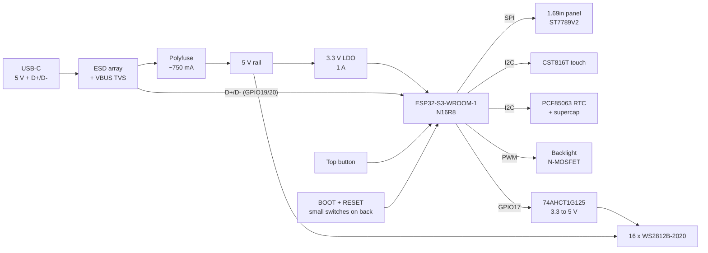

# bzzy main board, rev A (spec)

Status: **draft for review, nothing designed yet.** Written 2026-11-19. Every default below is a proposal. The decisions Adam needs to make are in [Open questions](#14-open-questions).

> Not legal advice. The certification section says what the rules appear to be and where to check, so the questions for a test lab are short ones. Facts I could not confirm from a primary source are marked **(verify)**.

## Contents

1. [Summary](#1-summary)
2. [Why a custom board](#2-why-a-custom-board)
3. [Goals and non-goals](#3-goals-and-non-goals)
4. [Module choice](#4-module-choice)
5. [Screen](#5-screen)
6. [Board architecture](#6-board-architecture)
7. [Layout concept](#7-layout-concept)
8. [Pin map and firmware impact](#8-pin-map-and-firmware-impact)
9. [BOM and cost at 10 to 25 units](#9-bom-and-cost-at-10-to-25-units)
10. [Making it at JLCPCB, and bench assembly](#10-making-it-at-jlcpcb-and-bench-assembly)
11. [Certification: Canada now, US later](#11-certification-canada-now-us-later)
12. [Case impact](#12-case-impact)
13. [Build plan](#13-build-plan)
14. [Open questions](#14-open-questions)
15. [Sources](#15-sources)

---

## 1. Summary

One board replaces both the Waveshare ESP32-S3-Touch-LCD-1.69 and the LED ring board. It keeps the ring board's **52 × 61 mm outline**, so the case carries over with small changes. On it:

- An **ESP32-S3-WROOM-1-N16R8** module: Espressif's pre-certified module with the antenna printed on it. It has the same chip, 16 MB flash and 8 MB PSRAM as the Waveshare board, so the firmware needs a new pin map and nothing else.
- The **same 1.69" 240 × 280 touch panel** (ST7789V2 display, CST816T touch), bought bare and plugged into an FPC connector, the way the Waveshare board does it.
- The **16 WS2812B-2020 LEDs**, 5 V level shifter and top button from rev C, with the rev D fixes folded in.
- **USB-C** for power and flashing, straight into the S3's own USB (no USB-to-serial chip), with ESD protection and a fuse.
- The **PCF85063 clock** with a supercap, so calendar blocks still switch on time after a short power cut.

Certification: because the radio is a certified module used exactly as certified, the product **inherits the module's ISED certification (IC: 21098-ESPS3WROOM1)**. bzzy itself then needs only an **ICES-003 Class B emissions test** (the "digital device" test), which Adam self-declares with a lab report. The same test run can produce the FCC Part 15B report for the US later.

Rough cost: **about US$22 to US$30 a board at 25 units** for the assembled board and screen, before case, box and shipping. One-off costs: about US$150 to US$250 for 5 prototypes, and **roughly CA$2,000 to CA$5,000 for the lab test (estimate, get quotes)**.

## 2. Why a custom board

The batch ordering spec (`docs/commerce/batch-orders.md`, 13.4) flagged radio certification as the biggest risk. Adam has since confirmed the Waveshare board has **no ISED certification**. Its radio is a bare ESP32-S3R8 chip with its own antenna, not a certified module, so it can't be sold in Canada inside bzzy unless the whole product goes through full radio certification (several thousand dollars more, and repeated for every board change).

Building on a certified Espressif module avoids that. Selling it built also benefits from one board instead of two: no hand-soldered wires between boards, one part to stock, and a thinner case.

The Waveshare board stays as the **development and test board**. Firmware keeps its build.

## 3. Goals and non-goals

Goals
- Sellable in Canada: certified radio module, ICES-003 compliant, labelled.
- Same experience as today: same screen, touch, ring light, top button, clock, OTA updates.
- Firmware unchanged apart from a pin map (a new PlatformIO env).
- JLCPCB assembles everything except the screen. Adam's bench work is: plug in the screen, flash, pair, close the case.
- Fits the existing case design with small changes.
- Reasonable at 10 to 25 units per batch, without a minimum order that strands money in parts.

Non-goals (for rev A)
- Battery power, wireless charging, or a Li-ion charger.
- Motion sensor (the Waveshare board's QMI8658). Firmware doesn't use it.
- A microphone or speaker. Roadmap "knock" might want a buzzer; see Q4.
- US sale in batch 1. The design and test plan keep it cheap to add (section 11.3).
- Secure boot and flash encryption. Signed OTA images already protect updates; locking the chip is a separate decision.

## 4. Module choice

All of these are Espressif modules with FCC and ISED modular certification. Prices are LCSC listings seen 2026-11-19 and move a lot **(verify at order time)**.

| | **ESP32-S3-WROOM-1-N16R8** (recommended) | ESP32-S3-WROOM-1-N8R2 | ESP32-S3-MINI-1-N8 | ESP32-S3-WROOM-1U-N16R8 | ESP32-C6-MINI-1 |
|---|---|---|---|---|---|
| Chip | ESP32-S3 | ESP32-S3 | ESP32-S3 | ESP32-S3 | ESP32-C6 (single core, Wi-Fi 6) |
| Flash / PSRAM | 16 MB / 8 MB octal | 8 MB / 2 MB quad | 8 MB / none | 16 MB / 8 MB octal | 4 or 8 MB / none |
| Size | 18 × 25.5 × 3.1 mm | same | 15.4 × 20.5 × 2.4 mm | 18 × 19.2 mm + antenna on a cable | 13.2 × 16.6 mm |
| Antenna | printed on module | printed | printed | u.FL to an external antenna | printed |
| FCC ID | 2AC7Z-ESPS3WROOM1 | same grant | 2AC7Z-ESPS3MINI1 | 2AC7Z-ESPS3WROOM1U | (verify) |
| ISED (IC) | **21098-ESPS3WROOM1** | same | 21098-ESPS3MINI1 | 21098-ESPS3WROOMU | (verify) |
| LCSC | C2913202 | C2913204 | C2913206 | C3013946 (was out of stock) | (verify) |
| Price, 1 to 30 pcs | ~US$3.70 to 6.40 | a little less | ~US$3.70 to 4.50 | ~US$6 | ~US$3 |
| Firmware | **same as Waveshare: drop-in** | new partitions, less GIF room | new partitions, no PSRAM | drop-in | C6 build exists, image already 1.57 MB of a 1.625 MB slot |

**Recommendation: ESP32-S3-WROOM-1-N16R8.**

- It is the same memory as the Waveshare board, so the 16 MB partition table, OTA slots and GIF storage don't change and every board runs the same firmware image apart from pins.
- 8 MB PSRAM keeps headroom for full-screen GIFs and future features. The MINI-1-N8 would work today (the C6 board proves bzzy runs without PSRAM), but it saves under a dollar and costs headroom.
- Printed antenna rather than -1U: the certification covers specific antennas, and a printed antenna can't be swapped, bent or left unplugged at the bench. The -1U is the fallback only if the layout can't give the antenna a clear edge (section 7).
- C6 is not recommended: the firmware image barely fits its 4 MB flash today, and there is no PSRAM.

Integration rules for keeping the module certification (from the module grant and Espressif's guidance; **verify against the module's user manual**):

1. Don't modify the module or its shield. Use only the printed antenna.
2. **Antenna keep-out:** no copper, traces, vias or parts on any layer under the antenna, and keep metal well away from it. Put the antenna end at a board edge, ideally flush or slightly overhanging. Use Espressif's ESP32-S3 Hardware Design Guidelines keep-out figure as the exact shape; plan on about 15 mm of clear space around the antenna in the plane of the board until checked.
3. Don't raise transmit power above Espressif's defaults or change the RF calibration data. Lowering it (the firmware's `BZZY_WIFI_TX_POWER`) is fine.
4. Set the Wi-Fi country to Canada (channels 1 to 11).
5. Keep the device used at least 20 cm from people, which a desk light naturally is. Check the module grant's RF exposure condition.
6. Label the product "Contains IC: 21098-ESPS3WROOM1" (and "Contains FCC ID: 2AC7Z-ESPS3WROOM1" for the US).

## 5. Screen

Keep the **1.69" 240 × 280 IPS panel with ST7789V2 driver and CST816T touch**: same look, same firmware drivers, same case window.

Two ways to buy it:

| | **A. Bare panel with FPC tail** (recommended) | B. Waveshare "1.69inch Touch LCD Module" |
|---|---|---|
| What it is | The glass, backlight and touch layer with a flat flex tail, like on the Waveshare dev board | The same panel already mounted on Waveshare's small board, with a 12-pin GH1.25 cable |
| Price | ~US$5 to 10 each from AliExpress/Alibaba panel makers **(verify; get samples)** | ~US$14 to 23 (seen US$22.52 at Abra, A$21 at 25+ at Core Electronics) |
| On our board | FPC connector, backlight transistor, a few passives | GH1.25 12-pin socket, nothing else |
| Thickness | thinnest; panel sits flat on the board | adds the module's PCB, about 2 to 4 mm |
| Risk | pinouts differ between vendors; need the vendor's datasheet and 2 or 3 sample panels | single, known source; 32-week lead times have been listed on non-touch versions |

**Recommendation: A, with B as a fallback footprint.** Lay out the FPC connector for the panel we sample, and also put an unpopulated GH1.25 12-pin footprint on the back wired to the same signals. If a panel vendor disappears, a batch can use the Waveshare module without a new board.

Before layout: order 3 panels each from 2 vendors, get their datasheets (FPC pin count and order, backlight current and voltage, touch I2C address, outline drawing), and caliper them. Pick the one whose datasheet is complete.

Mounting: the panel sticks to the front of the board on a foam double-sided pad, and its tail folds around the bottom edge to a connector on the back. That's how most watch-style boards do it, and it means the screen can be added at the bench after JLCPCB assembly.

## 6. Board architecture



### 6.1 USB-C and power

- **Connector:** 16-pin USB 2.0 Type-C receptacle, mid-mount or top-mount, at the bottom centre where the Waveshare's socket is today, so the cable exits in the same place.
- **CC1/CC2:** a separate 5.1 kΩ pull-down on each, so C-to-C cables get 5 V.
- **ESD:** a USB ESD array on D+/D- and VBUS (USBLC6-2SC6 or similar), placed right at the connector. This also helps the ICES-003 and immunity side.
- **Fuse:** a resettable polyfuse on VBUS, about 750 mA hold, plus a 5 V TVS. A ferrite bead on VBUS before the 3.3 V regulator is cheap insurance for emissions (populate if the pre-scan needs it).
- **3.3 V:** an LDO rated 1 A (AMS1117-3.3 is a JLCPCB basic part and is fine from 5 V; SGM2212 or TLV757 are better-behaved alternatives). The S3's Wi-Fi peaks need at least 500 mA available. 22 µF in and out, plus the module's recommended 10 µF + 100 nF at its 3V3 pin.
- **5 V for LEDs:** straight off the fused 5 V rail, as on the ring board.
- **Power budget:** S3 average ~100 mA with peaks ~350 mA, backlight ~20 to 40 mA, LEDs capped at 250 mA in firmware (rev D plan) = under 650 mA peak, typically 200 to 400 mA. A USB 2.0 port only promises 500 mA without negotiation, so **keep the 250 mA LED cap and consider 200 mA** if a laptop port ever browns out. Ship no power adapter (batch spec 13.3).

### 6.2 MCU module

- EN pin: 10 kΩ pull-up and 1 µF to ground (Espressif's RC reset delay), and a small RESET switch.
- GPIO0: 10 kΩ pull-up and a small BOOT switch. Only needed to rescue a board whose firmware has broken USB; normal flashing and OTA don't need it. Both switches sit on the back, reachable through a pinhole, or are replaced by test pads (Q7).
- Strapping pins 3, 45 and 46 left at defaults. Octal PSRAM uses GPIO35 to 37, so those are unavailable.
- Native USB: GPIO19 (D-) and GPIO20 (D+) to the connector via the ESD array, as a short, matched pair over solid ground. No series resistors needed for USB full speed.

### 6.3 Screen, touch and backlight

- SPI (write-only) at 40 to 80 MHz: SCLK, MOSI, CS, DC, RST. A 22 to 33 Ω series resistor on SCLK near the module softens edges, which helps emissions.
- Backlight: N-MOSFET low-side switch driven by PWM, with the series resistor the panel datasheet calls for. Same PWM pin as the Waveshare (GPIO15).
- Touch: CST816T on the panel's tail, on the shared I2C bus with 4.7 kΩ pull-ups, plus INT and RST lines.

### 6.4 Clock

PCF85063 (same chip as Waveshare, same firmware driver) with a 32.768 kHz crystal and a **0.22 F supercap** through a Schottky diode and resistor. It keeps time for roughly a few days unpowered, enough for a weekend unplugged, and needs no coin cell to ship or replace **(verify the hold time against the cap and RTC current at layout)**. A coin cell is the alternative if Adam wants months (Q3).

### 6.5 LED ring and top button (from rev C, plus rev D)

- 16 × WS2812B-2020 around the screen, chained from GPIO17 through a 74AHCT1G125 shifter, 33 Ω series, 100 kΩ pull-down so the LEDs stay dark at boot. 100 nF per LED and 2 × 10 µF bulk, as rev C.
- **Rev D items fold in here**: the review tweaks from the ring board thread and the firmware LED cap 400 → 250 mA. (The ring-board rev D itself can stay on hold; it's only needed if the Waveshare stack is ever sold, which it can't be.)
- The antenna zone means the LEDs can't sit where the antenna is. Section 7 covers how the ring spacing changes.
- Top button: the same Alps SKRT side-push switch on the top edge, to GPIO18 with the internal pull-up. Unchanged behaviour.

### 6.6 PCB

- **4 layers**, 1.6 mm, JLCPCB standard. A solid ground layer under the module and USB pair is the single best thing for emissions and Wi-Fi range, and JLCPCB's 4-layer price is close to 2-layer at this size.
- Ground stitching vias round the board edge (but not in the antenna zone).
- Parts on both sides: LEDs and button on the front, module and everything else on the back (section 7).

## 7. Layout concept

Keep the outline **52 × 61 mm**, the M2 holes in the same four corners, and USB-C at bottom centre.

```
            top edge (button + wordmark in the case above)
   +-----------------------------------------------+
   | [ANTENNA ZONE ~18 x 8 mm  ]   (SW1 top btn)   |   <- module antenna flush with top edge,
   |  no copper, no LEDs           o  o  o  LED    |      at the top-left corner (back side)
   | o                                           o |
   | o        +-------------------------+        o |
   | o        |                         |        o |
   | o        |   1.69" panel (front)   |        o |   module body sits behind the
   |          |      ~30 x 37 mm        |          |   panel on the back side
   | o        |                         |        o |
   | o        +-------------------------+        o |
   |    o      [FPC conn] [LDO] [RTC]      o       |
   |       o     o      [USB-C]      o     o       |
   +-----------------------------------------------+
                      bottom edge
```

- **Module on the back, antenna end at the top edge, offset to one side.** The button moves to the opposite side of the top edge if needed (case button cap follows).
- **LEDs skip the antenna zone.** 16 LEDs over the remaining perimeter, slightly closer together. The 9.5 mm frosted border spreads light well, but the antenna corner will be a little dimmer. If that's visible, options are: (a) drop to 15 LEDs and space evenly round the rest; (b) use the -1U module with a small certified flex antenna stuck to the inside of the case top, which frees the whole ring for LEDs. Prototype (a) first.
- **Screen keeps its current position** in the window, so the case's light ring and frame need few changes.
- **The panel's metal backplate is at least ~11 mm from the antenna**, which leaves the antenna in the clear.
- Run the kicad-happy `kicad` and `emc` checks on the layout before ordering, as on rev C.

This is a concept. The exact antenna keep-out comes from Espressif's guidelines figure, and the exact panel outline comes from the chosen panel's drawing.

## 8. Pin map and firmware impact

Keep the Waveshare pin mapping so the firmware change is a new `config.h` block and a PlatformIO env.

| Function | GPIO | Same as Waveshare? |
|---|---|---|
| LCD SCLK / MOSI / CS / DC / RST | 6 / 7 / 5 / 4 / 8 | yes |
| LCD backlight (PWM) | 15 | yes |
| I2C SDA / SCL (touch, RTC) | 11 / 10 | yes |
| Touch INT / RST | 14 / 13 | yes |
| LED data | 17 | yes (ring board) |
| Top button | 18 | yes (ring board) |
| BOOT | 0 | yes |
| USB D- / D+ | 19 / 20 | yes |
| Spare, broken out to test pads | e.g. 1, 2, 21, 38 to 42 | |

Firmware changes:

- New env `bzzy_main_reva` extending `waveshare_s3_touch_lcd169`, with a `BZZY_BOARD_BZZY_MAIN_REVA` block in `config.h`: same pins, `BZZY_HAS_RTC 1`, `BZZY_HAS_TOUCH 1`, no IMU, `kLedMaxMilliamps` 250.
- Display offsets and colour order depend on the panel chosen. If it's the same panel family, they match the Waveshare.
- Memory: N16R8 = same `default_16MB.csv` partitions, OTA slots and GIF space. No change to OTA or the size check.
- Wi-Fi country code set to CA (section 4, rule 4). Check the firmware doesn't set a TX power above the default.
- Add the env to the release workflow so each `fw-v*` tag publishes a signed image for it. Devices already pick their image by board, so OTA works the same way.
- Optional: a "Regulatory" line on the device's info screen showing "Contains IC: 21098-ESPS3WROOM1". ISED allows electronic labelling on products with a screen (Notice 2014-DRS1003), but a printed label is simpler and is the default here.

## 9. BOM and cost at 10 to 25 units

Estimates in **US dollars**, per board, at 25 units. Part prices are LCSC/AliExpress ranges, not quotes **(verify when the BOM is real)**.

| Part | Qty | Est. each | Est. per board |
|---|---|---|---|
| ESP32-S3-WROOM-1-N16R8 module | 1 | 3.70 to 6.40 | 5.00 |
| 1.69" ST7789V2 + CST816T panel (bare, FPC) | 1 | 5 to 10 | 8.00 |
| WS2812B-2020 LED | 16 | 0.08 to 0.15 | 1.80 |
| 74AHCT1G125 shifter | 1 | 0.10 | 0.10 |
| USB-C 16-pin receptacle | 1 | 0.15 to 0.40 | 0.30 |
| USB ESD array + 5 V TVS | 2 | 0.10 to 0.20 | 0.30 |
| Polyfuse, ferrite | 2 | 0.05 | 0.10 |
| 3.3 V LDO, 1 A | 1 | 0.10 to 0.30 | 0.20 |
| PCF85063 + crystal | 1 + 1 | 0.30 + 0.15 | 0.45 |
| 0.22 F supercap + diode | 1 + 1 | 0.40 to 0.80 | 0.70 |
| FPC connector for the panel | 1 | 0.10 to 0.30 | 0.20 |
| Backlight MOSFET | 1 | 0.03 | 0.03 |
| Alps SKRT top button | 1 | 0.30 | 0.30 |
| BOOT + RESET switches | 2 | 0.05 | 0.10 |
| Passives (~40) | | | 0.50 |
| **Parts subtotal** | | | **~US$18** |
| PCB, 4-layer 52 × 61 mm (spread over 25) | | | 1.00 to 2.00 |
| JLCPCB assembly, double-sided (setup, stencils, extended-part fees and joints, spread over 25) | | | 3.00 to 6.00 |
| Shipping and duty to Canada (spread over 25) | | | 1.50 to 3.00 |
| **Assembled board + screen** | | | **~US$22 to 30** (about CA$31 to 42) |

At 10 units the fixed fees spread thinner: expect about US$28 to 38 per board. Ordering for 25 even when a batch closes at 10 is an option once demand is known, since leftover boards keep.

Compared with today: the Waveshare touch board alone is roughly US$20 to 25 retail before the ring board, so the custom board is about cost-neutral while making the product sellable.

The case, frosted border, button cap, clip, screws, foam pad, box and labels are extra and unchanged from the batch spec's assumptions.

## 10. Making it at JLCPCB, and bench assembly

- **JLCPCB PCBA, standard (not economic) service**, double-sided: needed for the module on the back and LEDs on the front. The module, LEDs and shifter are likely "extended" parts (a ~US$3 setup fee each per order). Keep the passives to basic parts.
- Module footprint: Espressif's own footprint, with the antenna area marked keep-out on all copper layers. Watch JLCPCB's placement preview for module and LED rotation (as on rev C: WS2812B-2020 +90°).
- Use JLCPCB's "global sourcing" or pre-order parts into the JLCPCB part library ahead of time if stock is low. The module had a few thousand in stock at LCSC.
- **Not assembled by JLCPCB:** the screen. Adam sticks the panel on with a pre-cut foam pad, folds the tail and clicks it into the FPC connector.
- **Bench steps per light (about 10 minutes):** plug in USB, run a flashing script (esptool: bootloader, partitions, signed firmware, OTA key) over the native USB, run a self-test screen (all LEDs, touch, clock, Wi-Fi scan), pair to the buyer's account (batch spec 7.2), close the case, stick on the label. Script lives in `firmware/scripts/` (to be written).
- Prototype order: **5 boards**, plus 6 sample panels, about US$150 to 250 delivered.

## 11. Certification: Canada now, US later

### 11.1 What the module gives us

The ESP32-S3-WROOM-1 holds **ISED certification 21098-ESPS3WROOM1** (Espressif, approval dated 2024-08-16 on the copy found) and **FCC ID 2AC7Z-ESPS3WROOM1**. Integrated per its conditions (section 4), bzzy does not need its own radio certification. **Verify the number on ISED's Radio Equipment List** before relying on it; the ISED and Espressif sites weren't reachable from the session that wrote this.

### 11.2 Canada (batch 1)

What bzzy itself needs:

1. **ICES-003, Class B** (information technology equipment, home use). It's self-declared: an accredited lab tests radiated and conducted emissions (CISPR 32 / ANSI C63.4 methods), Adam keeps the report and declares compliance. No ISED filing fee. Test with the radio on and the LEDs and a GIF running, powered from a typical USB adapter.
2. **Labels** on the back of the case (and in the manual): "Contains IC: 21098-ESPS3WROOM1" and "CAN ICES-003(B) / NMB-003(B)". Bilingual as needed; the batch spec's bilingual insert card can carry the manual statements.
3. **Manual statements:** the standard ISED licence-exempt notice in English and French, from RSS-Gen. (RSS-Gen Issue 6 was reportedly published 2026-07-30 with a one-year transition; the lab will know which wording applies.)
4. Keep a **technical file**: schematic, BOM showing the module part number, photos, test report, label artwork.

What it costs and takes **(estimates; get 2 or 3 quotes)**:

- ICES-003 Class B test: **roughly CA$2,000 to CA$5,000**, 1 to 3 weeks of lab time. Asking for the FCC Part 15B report in the same session usually adds little, because the limits and method are nearly the same.
- An optional **pre-scan** (half a day at the lab, often CA$800 to CA$1,500) on prototype boards catches problems before the formal test. Worth it for a first product.
- Labs to ask: accredited EMC labs in the Lower Mainland, or national ones (Nemko, Intertek, Bureau Veritas, Element, Eurofins). Ask each: ICES-003 + FCC 15B quote, pre-scan price, lead time, whether they'll review the module-integration conditions too.

### 11.3 United States (later)

- **FCC Part 15B** for the host, by **Supplier's Declaration of Conformity (SDoC)**. The SDoC needs a **responsible party located in the US** (a US company, distributor or compliance agent). That's the main extra step for a Canadian seller.
- Label "Contains FCC ID: 2AC7Z-ESPS3WROOM1" plus the Part 15 statement in the manual.
- Follow FCC KDB 996369 (module integration): confirm with the lab that the radio is used within the grant, so no permissive change is needed.
- The batch spec's US duty and shipping issues (6.3) still apply.

### 11.4 What would break the inherited certification

- Changing the antenna, or moving it next to metal or copper. Mitigation: follow the keep-out exactly, plastic case only, no metal clip near the antenna corner.
- Firmware raising TX power beyond the module's defaults.
- Switching to a module variant not on the same grant (for example -1U without a listed antenna). Any module change: re-check the grant.

## 12. Case impact

- **Same outline, same screws:** 52 × 61 mm board in place of the ring board, so `board_dims.scad` keeps `RING_W`/`RING_H`. The Waveshare pocket goes away.
- **Thinner:** no Waveshare board stacked behind the ring. The back shell shrinks by roughly the Waveshare's thickness minus the module's 3.1 mm. New `BOARD_STACK` parameter for the depth.
- **USB-C:** the socket is on our board edge, so the rev C ring notch isn't needed. Keep the case opening where it is.
- **Antenna corner:** no metal parts there, and no thick light-blocking ribs over it. The monitor clip is plastic and at the back; keep any metal screw or magnet out of the antenna corner.
- **Button:** may move along the top edge, away from the antenna (Q8). The wordmark stays.
- **Label:** a flat area on the back for the IC and ICES labels, about 25 × 12 mm.
- **Pinhole** for BOOT/RESET on the back, if kept (Q7).

## 13. Build plan

1. **Adam answers the open questions** (section 14). Everything else waits on Q1 to Q3.
2. **Sample panels:** order 3 each from 2 vendors, get datasheets, measure. Pick one. (1 to 3 weeks shipping.)
3. **Lab quotes:** email 2 or 3 labs for ICES-003 + FCC 15B and a pre-scan. In parallel with step 2.
4. **Schematic and layout, rev A,** in `hardware/main-board/`, generated the same way as the ring board. kicad-happy review (schematic, EMC, JLCPCB DFM). One draft PR.
5. **Firmware env** `bzzy_main_reva` (small PR, can land before boards arrive; CI builds it).
6. **Order 5 prototypes** from JLCPCB. (About 2 weeks.)
7. **Bring-up:** flash, screen, touch, LEDs, clock, Wi-Fi range test against the Waveshare, light uniformity in the case.
8. **Pre-scan** at the lab with a cased prototype. Fix and spin rev B if needed.
9. **Formal ICES-003 (+ FCC 15B) test**, labels, technical file.
10. **Batch 1** on the batch ordering system.

Rough elapsed time from answers to batch-ready: **2 to 3 months**, most of it shipping and lab lead time.

## 14. Open questions

Defaults are what this spec assumes until Adam says otherwise.

| # | Question | Default |
|---|---|---|
| Q1 | Screen: keep the same 1.69" 240 × 280 touch panel? | Yes, touch kept |
| Q2 | Antenna: printed on the module (WROOM-1), or a small external antenna on a cable (-1U)? | Printed; -1U only if the light ring looks uneven |
| Q3 | Clock backup through a power cut: supercap (days), coin cell (months), or none (time from Wi-Fi)? | Supercap |
| Q4 | Extras: drop the motion sensor? Add a buzzer footprint for the roadmap "knock" feature? | Drop the sensor; unpopulated buzzer footprint |
| Q5 | Assembly: JLCPCB does everything but the screen; Adam fits the screen, flashes, pairs and closes the case? | Yes |
| Q6 | US: certify for FCC in the same lab visit, or Canada only? | Canada only, but ask for a combined ICES-003 + 15B quote |
| Q7 | BOOT and RESET: small switches behind a pinhole, or test pads only? | Switches behind a pinhole |
| Q8 | OK for the top button to move along the top edge (and the antenna corner to be slightly dimmer)? | Yes, decide after prototypes |
| Q9 | Screen sourcing: bare panel from a panel maker, or Waveshare's touch module? | Bare panel, Waveshare footprint as fallback |
| Q10 | Module: N16R8 (drop-in firmware) over the slightly cheaper MINI-1-N8? | N16R8 |

## 15. Sources

Checked 2026-11-19. Espressif's and ISED's own sites weren't reachable from the writing session, so module numbers come from copies of Espressif's certificates and test reports; re-check on the primary sites.

- ESP32-S3-WROOM-1 ISED certificate (Sporton, 21098-ESPS3WROOM1): https://www.elecrow.com/download/product/CrowPanel/ESP32-HMI/Certificate/ESP32S3/ESP32-S3-WROOM-1_IC_Certification.pdf
- ESP32-S3-WROOM-1 module user manual, host label wording: https://manuals.plus/espressif/esp32-s3-wroom-1-bluetooth-module-manual
- FCC test reports for 2AC7Z-ESPS3WROOM1: https://fcc.report/FCC-ID/2AC7Z-ESPS3WROOM1/5645479.pdf
- ESP32-S3-WROOM-1U ISED certificate (Nemko, 21098-ESPS3WROOMU): https://documentation.espressif.com/ESP32-S3-WROOM-1U%20IC%20Certification.pdf
- ESP32-S3-MINI-1 IC certification (21098-ESPS3MINI1): https://www.espressif.com/sites/default/files/ESP32-S3-MINI-1 IC Certification.pdf
- Espressif certificates index: https://www.espressif.com/en/support/documents/certificates
- ESP32-S3-WROOM-1/1U datasheet: https://www.espressif.com/sites/default/files/documentation/esp32-s3-wroom-1_wroom-1u_datasheet_en.pdf
- ESP32-S3 Hardware Design Guidelines (antenna keep-out figure): https://www.espressif.com/sites/default/files/documentation/esp32-s3_hardware_design_guidelines_en.pdf
- LCSC listings: C2913202 (WROOM-1-N16R8), C2913206 (MINI-1-N8), C2913204 (WROOM-1-N8R2), C3013946 (WROOM-1U-N16R8)
- ISED Notice 2014-DRS1003 (electronic labelling): https://ised-isde.canada.ca/site/certification-engineering-bureau/en/general-notices/notice-2014-drs1003
- RSS-Gen Issue 6 news (secondary): https://ib-lenhardt.com/news/ised-publishes-rss-gen-and-rss-310-issue-6
- Waveshare 1.69" touch LCD module (ST7789V2 + CST816T, GH1.25 12-pin): https://www.waveshare.com/1.69inch-touch-lcd-module.htm ; prices: https://abra-electronics.com/ (WAVE-27057), https://core-electronics.com.au/
- Batch ordering spec, radio section: `docs/commerce/batch-orders.md` 13.4 (draft PR #81)
