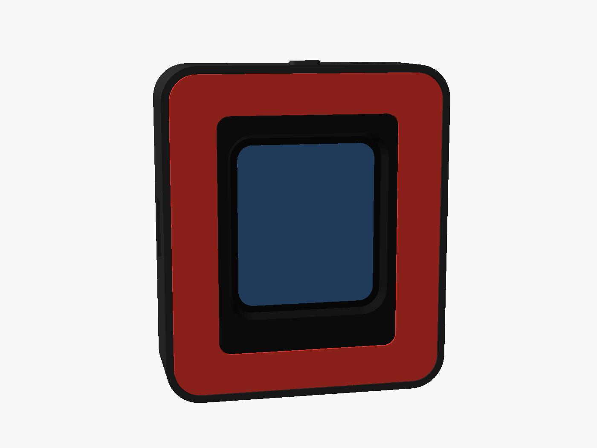
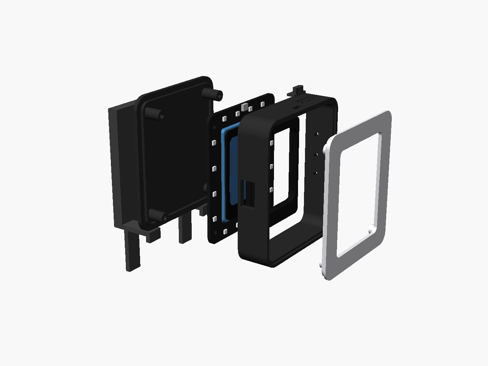
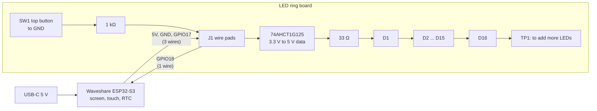
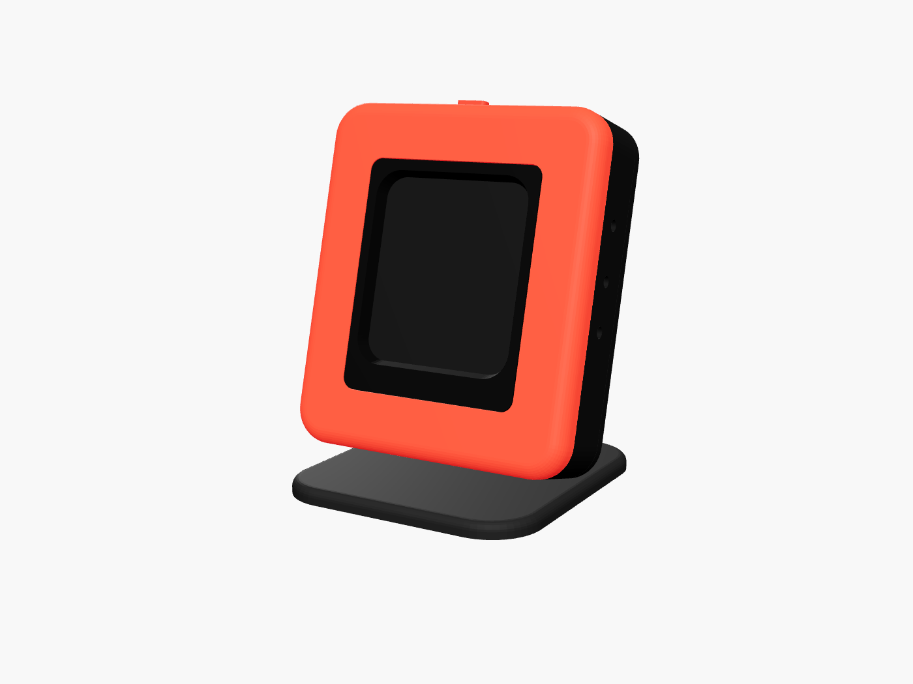
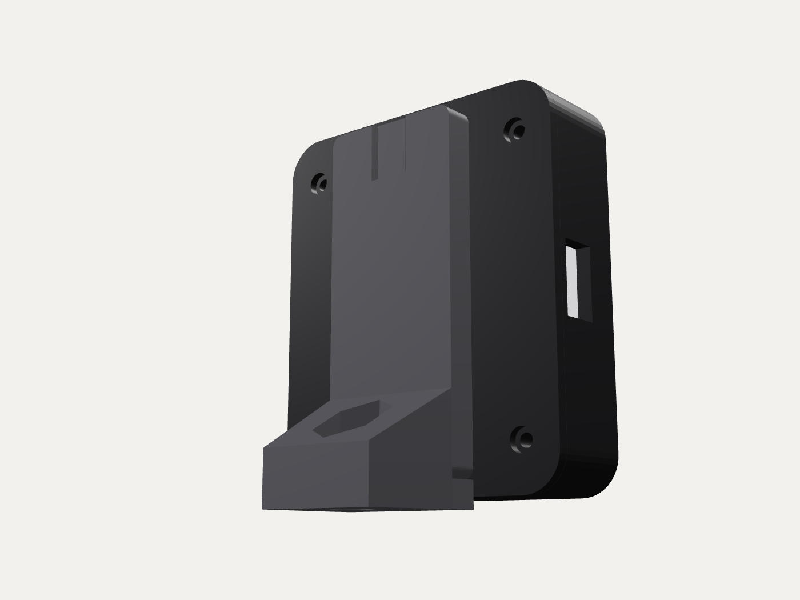
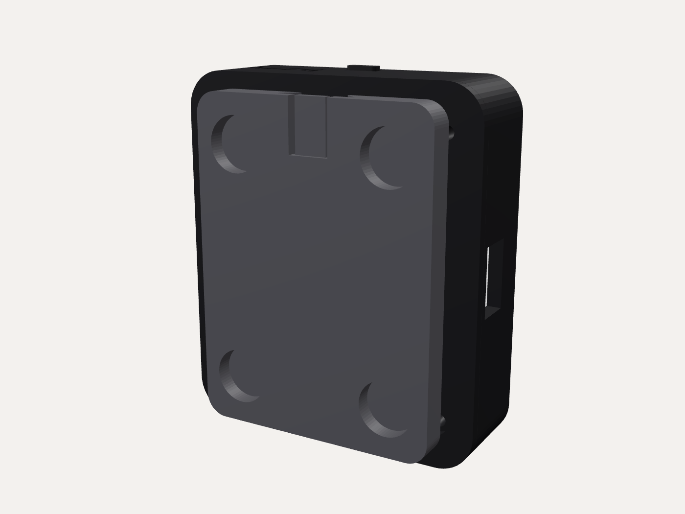

# bzzy hardware

bzzy hardware now runs on two tracks:

- **Main track: the bzzy main board** (being designed). One custom board with a certified ESP32-S3-WROOM-1U module, the bare 1.69" touch screen and the 16 LEDs. This is what built bzzys will be sold on, because the Waveshare board has no ISED radio certification and can't be sold inside one. Spec: [docs/hardware/main-board.md](../docs/hardware/main-board.md). Plan: [docs/plan.md](../docs/plan.md). Placement study: [main-board/](main-board/).
- **DIY side stream: Waveshare + LED ring board + printed case** (this page). For people building their own: buy a Waveshare board, order the ring board, get the case printed. It keeps the barrier to building one low, and work on it continues on the side.

> **Not built yet.** No LED ring board (rev B, B2, C or D) has been ordered, built or tested. Rev D is drawn from a real, caliper-measured Waveshare board and passes KiCad's design-rule check, but treat it as unproven until someone builds one. See [Before you order](#before-you-order).

The DIY build is a frame of light around the screen. It has four parts:

1. The **Waveshare ESP32-S3-Touch-LCD-1.69**, the brains and the screen. It's unchanged from the prototype.
2. A custom **LED ring board** with 16 small RGB LEDs. It sits around the Waveshare board.
3. A printed **frosted white border**, about 1 cm wide, round the screen. The LEDs light it in the status colour.
4. A printed **black case** round all of it, with a button on top, the bzzy wordmark, and a monitor clip.

Nothing changes in the firmware. The ring board uses the same data pin (GPIO17) and LED count (16) that `firmware/src/config.h` already has.

This is **rev D, never built**. Measuring a real Waveshare board showed its USB-C socket is halfway up the left edge, on the back of its PCB, not on the bottom edge as rev C assumed. So rev D drops rev C's bottom notch: the ring is a closed loop again, and sits far enough forward in the case that the plug passes behind it. It also takes in the fixes from the rev C design review. Nobody has built or tested one yet.

| Front | Busy (lit red) | Top: button and wordmark |
|---|---|---|
|  |  |  |
| **Back, with the clip** | **Exploded** | |
|  |  | |

## Plan

- **DIY side stream (rev D):** an LED ring board around the Waveshare board, with a button on top, plus a printed case. It's cheap and quick to get made, and fine for building your own. Next for it: check the last few estimates (see [Before you order](#before-you-order)), then order and test a ring.
- **Main track:** the [bzzy main board](../docs/hardware/main-board.md), for built bzzys that are sold. It keeps this ring board's 52 × 61 mm outline, corner holes and LED positions, so the case works for both.

## How it fits together



## LED ring board

Files are in [led-ring/](led-ring/). Open `bzzy-led-ring.kicad_pro` in KiCad 7 or later.

| | |
|---|---|
| Size | 52 × 61 mm, 2 layers, 1.6 mm. The 34.3 × 42.3 mm cutout fits the Waveshare board's 33.1 × 41.1 mm glass with 0.6 mm all round (checked on a 1:1 paper print, 2026-11-21). No copper within 2.7 mm of the M2 holes, so screw heads sit on bare board |
| Depth | The ring's front face sits 2.3 mm behind the front of the Waveshare glass. The USB-C plug comes in from the left behind the Waveshare PCB, so it passes behind the ring. That works for plug grips up to about 7.4 mm thick |
| LEDs | 16 × WS2812B-2020 (2 × 2 mm), 4 on each side, evenly spaced: every 10 mm along the top and bottom, every 12 mm down the sides. Chained clockwise from just left of the bottom middle |
| Data | GPIO17 (3.3 V), then a 74AHCT1G125 buffer to 5 V logic, then 33 Ω to the first LED. A 10 kΩ pull-down keeps the LEDs dark while the ESP32 boots |
| Power | 5 V from the Waveshare board's 5V pad. A 0.8 mm power ring on the back, a 100 nF cap per LED, and 2 × 10 µF bulk caps. Firmware caps the LEDs at 250 mA |
| Connection | J1 is four plated holes (2 mm apart) on the left side: IO18, 5V, GND and IO17 from top to bottom, labelled on the back. Solder four short wires to the matching pads along the bottom edge of the Waveshare board |
| Top button | SW1, an Alps SKRT side-push switch on the top edge, with its plunger pointing up. You press it through a black button cap in the case's top wall. It shorts GPIO18 to GND through a 1 kΩ resistor (R3, for ESD), and the firmware turns on the internal pull-up. Its mounting tabs are grounded |
| Mounting | 4 × M2 holes in the corners. The screws go through the case's back plate and the ring board into the light ring |
| Assembly | Every part is on the front, so JLCPCB assembles one side only. You hand-solder the four J1 wires |


| Front (LEDs) | Back (+5V ring, GND pour) |
|---|---|
|  |  |

### How it's made

[`led-ring/gen_led_ring.py`](led-ring/gen_led_ring.py) is the source of truth. It writes these files:

- the KiCad schematic, with connectivity checked against the script's netlist
- the PCB, with parts placed, traces routed and ground poured
- `fab/bom-jlcpcb.csv` and `fab/cpl-jlcpcb.csv`, for JLCPCB assembly
- `fab/drc-report.txt`. Rev D: **0 violations, 0 unconnected pads** (the 46 entries are KiCad warnings that the footprint libraries aren't in the project's library table). The switch's own land pattern puts its pads closer to its peg holes than the board rule allows, so `bzzy-led-ring.kicad_dru` allows that within SW1 only
- `case/board_dims.scad`, so the case always matches the board

The ring is regular, so the script routes it by rule instead of with an autorouter. Each LED's 5 V pad drops through a via onto the power ring. Its ground pad joins the ground pour. Its data out runs straight to the next LED, and the corners go round the screen side of the mounting holes. On the back, the button and data lines run in a lane just inside the power ring, which has a short gap at the top middle for the button line.

To change something, edit the script and run `./render.sh` (needs KiCad 7+ and OpenSCAD). Once the design settles, you can stop using the script and edit the board directly in KiCad.

### Bill of materials (per board)

| Ref | Qty | Part | Package | Notes |
|---|---|---|---|---|
| D1 to D16 | 16 | WS2812B-2020 | 2020 | Addressable RGB LED |
| U1 | 1 | 74AHCT1G125 | SOT-23-5 | Level shifter. A 74HCT1G125 works too |
| C1, C4 to C19 | 17 | 100 nF, X7R, 16 V | 0402 | |
| C2, C3 | 2 | 10 µF, X5R, 10 V+ | 0805 | |
| R1 | 1 | 10 kΩ | 0402 | Data pull-down |
| R2 | 1 | 33 Ω | 0402 | |
| R3 | 1 | 1 kΩ | 0402 | Button line, ESD |
| SW1 | 1 | Alps SKRTLAE010 | SMD side-push | Top button |
| J1 | – | 4 plated holes, 2.0 mm | – | Wires, hand-soldered |
| Screws | 4 | M2 × 8 self-tapping (or M2 × 8 with heat-set inserts in the light ring) | | |

`fab/bom-jlcpcb.csv` has an LCSC part number for every line (set in `gen_led_ring.py`, and also written into the schematic as an `LCSC` field). Check each match in JLCPCB's BOM step, and swap in a Basic part where one fits, since each Extended part adds a small fee. The WS2812B-2020, the 74AHCT1G125 and the SKRTLAE010 are Extended. On 2026-11-21 the original LED (C965555) and Nexperia's 74AHCT1G125GV (C12494) were out of stock at JLC, so the BOM now uses C52917434 (WS2812B-2020-V6, same package and pins) and C7484 (TI SN74AHCT1G125DBVR, same SOT-23-5 pinout). Either original is fine if it's back in stock. A WS2812B-2020 is only placed with Standard assembly, not Economic.

`fab/cpl-jlcpcb.csv` uses the same coordinates as the Gerbers, and its rotations already include JLCPCB's usual offsets (+180° for SOT-23-5, +90° for the WS2812B-2020). JLCPCB's own footprint decides the real orientation, so still check the preview.

**Rough cost:** about US$30 to $50 for 5 assembled boards before shipping and duty. That's an estimate, not a quote.

## Case

[`case/bzzy_case.scad`](case/bzzy_case.scad) is parametric OpenSCAD. The case is black, with the screen in the middle of a frosted white border about 1 cm wide (9.2 mm at the sides, 8.2 mm top and bottom). The LEDs sit under the border. Overall it's about 58 × 67 × 17.5 mm, plus whichever mount it sits on (see [Mounts](#mounts)).

Looking at the front, from the middle out: the screen, set 2.5 mm deep behind a black trim over the Waveshare board's own glass edge (the window opens out at 45° so it doesn't shade the screen), the frosted border, then a 1.4 mm black rim. The border starts at the Waveshare board's edge, not at the lit screen, because no LED can sit under the board. The ring board didn't need to change for this.

Export a part with:

```sh
openscad -D 'PART="light"' -o light.stl case/bzzy_case.scad   # or frame, back, trim, button, clip
```

`./render.sh` exports all six to `case/stl/`, each already turned the way it prints best. They aren't committed until the measurements are confirmed.

| Part | Colour and material | Notes |
|---|---|---|
| light | **Frosted white.** Translucent white PETG, or clear or white resin (SLA) with a matte finish | The glowing border. 1.6 mm thick at the front, about 2.4 mm in front of the LEDs. Its outer lip sits over the frame's rim, and four bosses take the screws. Print it face down |
| frame | **Black.** PLA, PETG, or MJF nylon (PA12, dyed black) | Front rim and the four side walls, with the USB-C opening on the left, pinholes for the Waveshare's PWR, BOOT and RST buttons on the right, and the button hole and wordmark on top. Print it face down |
| back | **Black** | Back plate. Four posts press the ring board forward and the screws go through them. Dovetail rail for the clip |
| trim | **Black** | Sleeve round the Waveshare board, with the thin trim round the screen. Keeps LED light off the display. The light ring holds it down |
| button | **Black** | Cap for the top button. Sits in a pocket in the frame's top wall, held in by its flange. Print it flange down |
| clip | **Black.** PETG or nylon (needs some flex) | Slides up the rail. Two legs rest on the monitor's top edge, with a lip at the front and a drop at the back. Set `MONITOR_T` to your monitor's thickness |

**For a print service** (JLC3DP, Craftcloud, a local shop): order `light.stl` in translucent or white resin, and the other five in black. MJF nylon in black is tough and has no visible layers, which suits the frame and clip. Resin is fine for the light ring, but ask for the "translucent" or "semi-transparent" option with a matte or sanded finish, so the LEDs don't show as dots. None of the parts need supports in the orientation they're exported in, except the back plate, which stands on its rail. Ask the service to orient it, or use MJF or resin, where it doesn't matter.

### How it goes together

1. Put the button cap into its pocket in the frame's top wall, from the inside.
2. Hold the frame face up and drop the light ring in from the front, so its lip sits on the frame's rim. Turn the two over together, face down on the table.
3. Put the trim in from the back, face down, through the light ring's middle.
4. Put the ring board, LEDs down, onto the light ring's bosses, then the Waveshare board into the trim. The button cap now rests just off the switch.
5. Put a square of 3 mm foam tape on the back of the Waveshare board, then put the back plate on and do up the four M2 screws. They pull the light ring back, and its lip clamps the frame's rim against the back plate. No glue.
6. Slide the clip up the rail.

### The top button

The switch only travels 0.2 mm, and its plunger tip sits on the board's routed edge, which is only accurate to about ± 0.2 mm. So the cap rests 0.1 mm off the plunger and can float 0.5 mm outwards. A board that comes back slightly large pushes the cap out a little, instead of holding the switch down. If the switch were held down, the device would boot into setup every time. `TOP_BTN_Z` is the plunger's height above the board (0.8 mm for the Alps SKRT). Check it against the switch once you have one.

### The wordmark

"bzzy" is debossed 0.6 mm into the top face, right of the button, in Geist SemiBold, the font the app uses, with tight tracking. The font is in `case/fonts/` (SIL Open Font License). Set `LOGO` to move it:

| `LOGO` | Where |
|---|---|
| `"top"` (default) | Top face, right of the button. People standing at your desk see it |
| `"chin"` | Front, in a 9 mm black chin below the border. The device gets taller and the screen sits above centre |
| `"back"` | Back plate, above the clip rail. Hidden when the device is on the monitor |
| `"none"` | No wordmark |

## Mount rail (standard)

Every mount fits the case the same way: it slides onto a dovetail rail down the middle of the back plate. Keep these numbers fixed so any mount fits any case.

| | |
|---|---|
| Profile | Dovetail with 45° flanks: **8.0 mm** wide where it meets the back face, **14.0 mm** wide at its outer face, standing **3.0 mm** off the back |
| Length | **56.8 mm**, centred on the case, starting 5 mm above the bottom edge and ending 5 mm below the top (shorter, 42.8 mm, with `LOGO = "back"`) |
| Mount slot | The rail's profile grown by **0.25 mm** all round (`RAIL_FIT`): 8.5 mm at the mouth, 14.5 mm inside, 3.25 mm deep |
| Direction | The device drops down onto the mount, so the slot is open at the top and closed at the bottom. That closed end is the stop, and gravity holds the device on it |

The rail is built from `RAIL_W`, `RAIL_T`, `RAIL_FIT` and `RAIL_L` in `case/bzzy_case.scad`. A mount design should read those rather than copying the numbers.

## Mounts

[`case/bzzy_mounts.scad`](case/bzzy_mounts.scad) holds the mounts. Each one is built on the same carriage: a block with a slot that fits the rail above, so they all fit every case. Swap mounts by lifting the device off one and dropping it onto another.

| Stand | Tripod adapter | Magnet plate |
|---|---|---|
|  |  |  |

| Mount | What it's for | Extra parts |
|---|---|---|
| `stand` | Desk stand. Leans the device back 15° (`STAND_TILT`) on a 52 × 50 mm base. The USB-C cable comes out the left side, clear of the base | Four small rubber feet, if you like |
| `tripod` | A 1/4"-20 camera thread under a block behind the device. Fits mini tripods, phone clamp arms, monitor-arm camera mounts and suction-cup mounts | One 1/4"-20 hex nut (7/16" across flats). Press it into the pocket from the top. A drop of glue if it's loose |
| `magnet` | Flat plate with four magnet pockets in its back. Sticks to a filing cabinet, steel cubicle panel, whiteboard or fridge. Without magnets, stick it to a wall with double-sided tape | Four 10 × 3 mm disc magnets (N42 or N52). Glue them in flush with CA or epoxy |

Export one with:

```sh
openscad -D 'MOUNT="stand"' -o stand.stl case/bzzy_mounts.scad   # or tripod, magnet
```

`MOUNT = "show_stand"` (or `show_tripod`, `show_magnet`) shows it with the device on it. Print them in black, like the case. MJF nylon (PA12) or PETG suit the snap best; PLA works but the snap wears sooner. None needs supports in the orientation it's exported in.

### The snap

The rail standard only needs gravity, but a knock could lift the device off a mount. So each carriage has a small sprung tongue, 6 × 10 mm, in the floor of its slot, with a bump at its tip. As the device drops in, the bump rides on the rail's outer face (0.35 mm of interference), then clicks over the rail's top end when the device is home. The bump's catching face is 45°, so a firm lift (roughly half a kilogram) still pulls the device off. Set `SNAP_H` smaller for a softer click, or larger for a firmer one.

The tongue is thinner than the floor behind it, so it can flex even when the magnet plate's back is flat on a wall. A new mount that adds anything behind the carriage must keep that space clear: subtract `tongue_relief()`, as the stand and tripod adapter do.

The snap is all in the mount, so the rail and the case don't change. The monitor clip (`PART = "clip"` in the case file) still uses the plain slot without a snap. It's on hold until the monitor is measured.

### Designing your own mount

Include the mounts file, call `carriage(width)`, and add your mount behind it (towards −z). The carriage sits where it fits on the device, in the case's coordinates: `CAR_Z0` is its back face and `CAR_Y0` and `CAR_Y1` its bottom and top. Cut `device_keepout()` and `tongue_relief(depth)` out of whatever you add. Set `PART` and `MOUNT` so the included files draw nothing:

```openscad
include <bzzy_mounts.scad>
MOUNT = "none";
difference() {
  union() { carriage(26); /* your mount, behind CAR_Z0 */ }
  device_keepout(); tongue_relief(3);
}
```

## Before you order

Rev D uses caliper measurements of a real Waveshare board (2026-11-21): the 33.1 × 41.1 mm glass (nothing overhangs it, not even the ribbon), 10.5 mm total thickness, 1.8 mm glass, 5.4 mm from the front of the glass to the front of its PCB, the 27.7 × 32.2 mm lit area and its 2.4 / 5.6 mm top and bottom borders, the USB-C socket's size and depth (centre 7.9 mm behind the glass front), and the side buttons' depth (7.1 mm). Two positions along the edges still come from photos, so they're **estimates**. With calipers, measuring from the top edge of the glass:

1. **USB-C socket centre** (`USB_Y` in the case). It only moves the opening in the case's left wall.
2. **PWR, BOOT and RST button centres** (`SIDE_BTNS`). Pinholes in the right wall.
3. **Your cable's plug grip.** The ring clears grips up to about 7.4 mm thick, and the case opening is 12.5 × 7.4 mm.

The screen window's offset (`SCREEN_DY = 1.6`) splits a 0.9 mm disagreement: the lit height (32.2 mm) plus the two borders comes to 40.2 mm, against 41.1 mm of glass. If the window looks off-centre on the first print, measure from the glass's top edge to the first lit pixel and adjust it.

Checked on a real board:

- **The Wi-Fi antenna** is the small chip at the top edge, right of centre. The ring has no ground pour on either layer in the strip next to it (`ANTENNA_KEEPOUT`). Once it's built, compare the Wi-Fi signal (RSSI) of the bare board with the same board inside the ring.
- **The 5V pad** reads 5.12 V on a MacBook Air's USB-C port, comfortably above the 74AHCT1G125's 4.5 V minimum.

Then print the frame, light ring and back once in cheap PLA to check the fit before ordering boards.

## Ordering from JLCPCB

1. Use `led-ring/fab/gerbers.zip`, which is committed. `./render.sh` regenerates it. Or, in KiCad, export Gerbers and drill files (File, Fabrication Outputs) with JLCPCB's KiCad settings, and zip the folder.
2. Upload the zip at jlcpcb.com. Defaults are fine: 2 layers, 1.6 mm, HASL lead-free or ENIG, any colour. Black or white looks best behind a translucent frame.
3. Turn on **PCB Assembly**, top side, and upload `fab/bom-jlcpcb.csv` and `fab/cpl-jlcpcb.csv`.
4. In the parts-matching step, confirm the LCSC part on each line. In the placement preview, **check every LED, U1 and SW1**: the pin 1 dot should match the KiCad drawing. U1 matters most: placed backwards, it gets 5 V on its GND pin. Checked in JLC's preview on 2026-11-21: U1 (C7484) is right with the SOT-23 +180° offset, and the LEDs (C52917434) need no offset; the old +90° put their terminals across the pads. Still glance at every part, since JLC's footprint for a given LCSC part is what counts. Fix any rotation in the preview if needed.

## The main board

The custom board that used to be called "v2" is now the main track: one board with an ESP32-S3-WROOM-1U module, the bare screen, USB-C, a clock and the LEDs. Its full spec, including the certification path, is [docs/hardware/main-board.md](../docs/hardware/main-board.md).

## Open questions

- Are 16 LEDs enough? Firmware handles more, and TP1 lets you chain extras.
