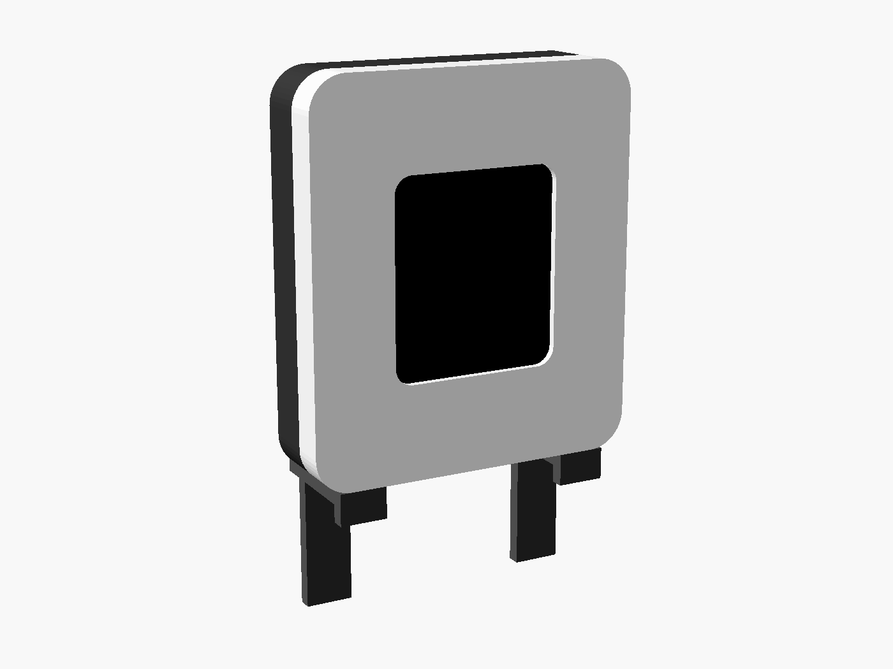
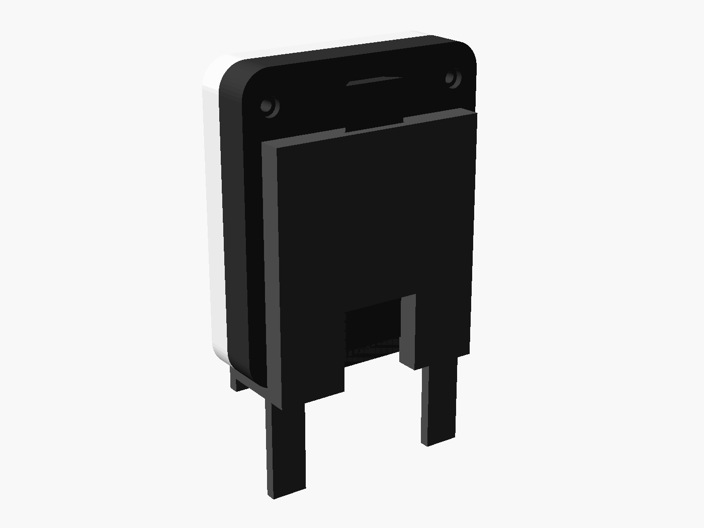
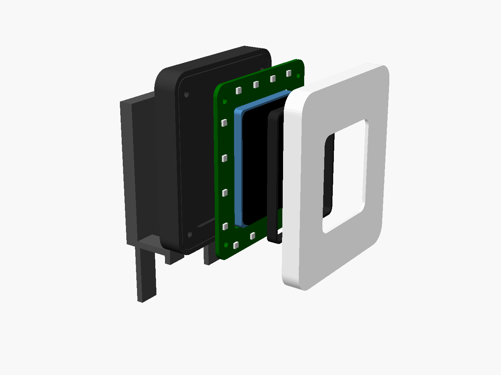
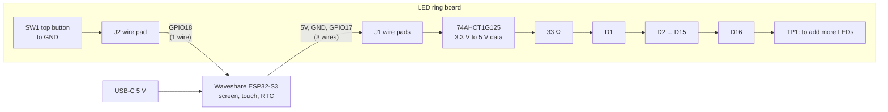
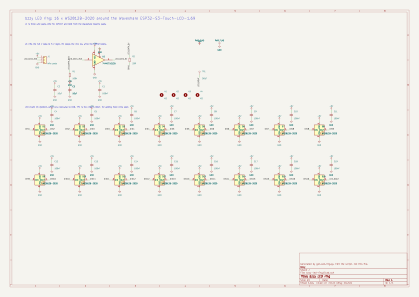
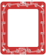

# bzzy hardware

The final device is a frame of light around the screen. It has four parts:

1. The **Waveshare ESP32-S3-Touch-LCD-1.69**, the brains and the screen. It's unchanged from the prototype.
2. A custom **LED ring board** with 16 small RGB LEDs. It sits around the Waveshare board.
3. A printed **translucent frame** in front of the LEDs. The whole border glows in the status colour.
4. A printed **back shell and monitor clip**.

Nothing changes in the firmware. The ring board uses the same data pin (GPIO17) and LED count (16) that `firmware/src/config.h` already has.

This is **rev C, a concept**. Rev C opens the bottom of the ring so a USB-C plug can reach the Waveshare socket (rev B added the button on top). The board has been through KiCad's design-rule check, but nobody has built one yet. Measure the Waveshare board before you order anything (see [Before you order](#before-you-order)).

| Front | Back | Exploded |
|---|---|---|
|  |  |  |

## Plan

- **Now (rev C):** an LED ring board around the Waveshare board, with a button on top, plus a printed case. It's cheap and quick to get made.
- **v2 (later):** one custom board with the ESP32-S3, the bare screen, USB-C and the LEDs. See [v2: full custom board](#v2-full-custom-board).

## How it fits together



## LED ring board

Files are in [led-ring/](led-ring/). Open `bzzy-led-ring.kicad_pro` in KiCad 7 or later.

| | |
|---|---|
| Size | 52 × 61 mm, 2 layers, 1.6 mm. The 34.2 × 42.7 mm cutout fits the Waveshare board. A 14 mm notch at the bottom middle opens the cutout to the edge, so the USB-C plug can pass through the ring. No copper within 2.7 mm of the M2 holes, so screw heads sit on bare board |
| LEDs | 16 × WS2812B-2020 (2 × 2 mm), every 10 to 12 mm, chained clockwise from just left of the notch |
| Data | GPIO17 (3.3 V), then a 74AHCT1G125 buffer to 5 V logic, then 33 Ω to the first LED. A 100 kΩ pull-down keeps the LEDs dark while the ESP32 boots |
| Power | 5 V from the Waveshare board's 5V pad. A 0.8 mm power ring on the back, a 100 nF cap per LED, and 2 × 10 µF bulk caps. Firmware caps the LEDs at 400 mA |
| Connection | J1 is three plated holes on the left side (5V, GND, IO17 from top to bottom, labelled on the back). J2 is one plated hole at the top, right of the button (IO18). Both are clear of the USB-C plug. Solder four short wires to the Waveshare board's 5V, GND, GPIO17 and GPIO18 pads |
| Top button | SW1, an Alps SKRT side-push switch on the top edge, with its plunger pointing up. You press it through a flexing tab in the case's top wall. It shorts GPIO18 to GND, and the firmware turns on the internal pull-up |
| Mounting | 4 × M2 holes in the corners. The screws go through the shell and the ring board into the diffuser |
| Assembly | Every part is on the front, so JLCPCB assembles one side only. You hand-solder the J1 and J2 wires |



| Front (LEDs) | Back (+5V ring, GND pour) |
|---|---|
|  |  |

### How it's made

[`led-ring/gen_led_ring.py`](led-ring/gen_led_ring.py) is the source of truth. It writes these files:

- the KiCad schematic, with connectivity checked against the script's netlist
- the PCB, with parts placed, traces routed and ground poured
- `fab/bom-jlcpcb.csv` and `fab/cpl-jlcpcb.csv`, for JLCPCB assembly
- `fab/drc-report.txt`. Rev C: **0 violations, 0 unconnected pads**. The switch's own land pattern puts its pads closer to its peg holes than the board rule allows, so `bzzy-led-ring.kicad_dru` allows that within SW1 only
- `case/board_dims.scad`, so the case always matches the board

The ring is regular, so the script routes it by rule instead of with an autorouter. Each LED's 5 V pad drops through a via onto the power ring. Its ground pad joins the ground pour. Its data out runs straight to the next LED, and the corners go round the screen side of the mounting holes.

To change something, edit the script and run `./render.sh` (needs KiCad 7+ and OpenSCAD). Once the design settles, you can stop using the script and edit the board directly in KiCad.

### Bill of materials (per board)

| Ref | Qty | Part | Package | Notes |
|---|---|---|---|---|
| D1 to D16 | 16 | WS2812B-2020 | 2020 | Addressable RGB LED |
| U1 | 1 | 74AHCT1G125 | SOT-23-5 | Level shifter. A 74HCT1G125 works too |
| C1, C4 to C19 | 17 | 100 nF, X7R, 16 V | 0402 | |
| C2, C3 | 2 | 10 µF, X5R, 10 V+ | 0805 | |
| R1 | 1 | 100 kΩ | 0402 | |
| R2 | 1 | 33 Ω | 0402 | |
| SW1 | 1 | Alps SKRTLAE010 | SMD side-push | Top button |
| J1 | – | 3 plated holes, 2.54 mm | – | Wires, hand-soldered |
| J2 | – | 1 plated hole, 1.5 mm pad | – | Wire to GPIO18, hand-soldered |
| Screws | 4 | M2 × 8 self-tapping (or M2 × 8 with heat-set inserts in the diffuser) | | |

`fab/bom-jlcpcb.csv` has an LCSC part number for every line (set in `gen_led_ring.py`). Check each match in JLCPCB's BOM step, and swap in a Basic part where one fits, since each Extended part adds a small fee. The WS2812B-2020, the 74AHCT1G125 and the SKRTLAE010 are probably Extended.

`fab/cpl-jlcpcb.csv` uses the same coordinates as the Gerbers, and its rotations already include JLCPCB's usual offsets (+180° for SOT-23-5, +90° for the WS2812B-2020). JLCPCB's own footprint decides the real orientation, so still check the preview.

**Rough cost:** about US$30 to $50 for 5 assembled boards before shipping and duty. That's an estimate, not a quote.

## Case

[`case/bzzy_case.scad`](case/bzzy_case.scad) is parametric OpenSCAD. Export a part with:

```sh
openscad -D 'PART="diffuser"' -o diffuser.stl case/bzzy_case.scad   # or baffle, shell, clip
```

`./render.sh` exports all four to `case/stl/`. They aren't committed until the measurements are confirmed.

| Part | Material | Notes |
|---|---|---|
| diffuser | Translucent white PETG, or white resin (SLA) | Front frame and sides, all one glowing piece. Print it face down. The 1.2 mm front is thin enough for an even glow, about 4 mm from the LEDs. The top wall has a flexing tab with a nub that presses the top button. Set `TOP_BTN_Z` to the plunger's height once you have the switch |
| baffle | Black PLA or PETG | Sleeve round the screen, so LED light doesn't leak onto the display |
| shell | Black PLA, PETG or MJF nylon | Back cover with a USB-C opening and BOOT-button pinhole on the bottom, plus a dovetail rail for the clip |
| clip | PETG or nylon (needs some flex) | Slides up the rail. Two legs rest on the monitor's top edge, with a lip at the front and a drop at the back. Set `MONITOR_T` to your monitor's thickness |

Overall it's about 56 × 65 × 15 mm, plus the clip. You can put a square of 3 mm foam tape behind the Waveshare board to press it against the front.

## Before you order

Waveshare only publishes the board's outline as a drawing, which I couldn't read from here, so a few numbers are **estimates**. With calipers, measure:

1. **The Waveshare board's width, height and total thickness** (`WS_W`, `WS_H`, `WS_T` in `gen_led_ring.py`). The cutout and case follow from these. I used 33.0 × 41.5 × 9.5 mm.
2. **Where the screen sits**: the visible area's size, and whether it's centred on the board (`SCREEN_*`, `SCREEN_DY` in the case).
3. **The glass height**: when the Waveshare board sits in the ring's cutout, how far its glass stands proud of the ring board's front face (`GLASS_Z`).
4. **USB-C and BOOT button positions** (`USB_*`, `BUTTON_*`). I assumed the USB-C socket is on the bottom edge, in the middle.
5. **Your monitor's top edge thickness** (`MONITOR_T`).

Then print the shell and diffuser once in cheap PLA to check the fit before ordering boards.

## Ordering from JLCPCB

1. Run `./render.sh`, which writes `led-ring/fab/gerbers.zip`. Or, in KiCad, export Gerbers and drill files (File, Fabrication Outputs) with JLCPCB's KiCad settings, and zip the folder.
2. Upload the zip at jlcpcb.com. Defaults are fine: 2 layers, 1.6 mm, HASL lead-free or ENIG, any colour. Black or white looks best behind a translucent frame.
3. Turn on **PCB Assembly**, top side, and upload `fab/bom-jlcpcb.csv` and `fab/cpl-jlcpcb.csv`.
4. In the parts-matching step, confirm the LCSC part on each line. In the placement preview, **check every LED, U1 and SW1**: the pin 1 dot should match the KiCad drawing. U1 matters most: placed backwards, it gets 5 V on its GND pin. Fix any rotation in the preview if needed.

## v2: full custom board

These are notes for later, once the ring board has proven the case and the light.

- **MCU:** an ESP32-S3-WROOM-1-N16R8 module. It has the same 16 MB flash and 8 MB PSRAM as the Waveshare board, plus a certified antenna. Keep the module's antenna end at the top edge, with no copper or LEDs under it.
- **Screen:** the bare 1.69" 240 × 280 ST7789V2 panel with CST816T touch on an FPC connector. Waveshare sells the panel separately as the "1.69inch Touch LCD Module". Find the panel's FPC pinout before laying out.
- **Pins:** keep the Waveshare mapping (LCD 4 to 8 and 15, I2C 10 and 11, touch 13 and 14, LEDs 17, top button 18, BOOT 0). The firmware then only needs a new PlatformIO env, or none at all.
- **Power:** USB-C into the S3's native USB (GPIO19 and 20), with 5.1 kΩ CC resistors, ESD protection and a fuse. A 3.3 V LDO rated 1 A for the S3's Wi-Fi peaks, and the LEDs straight off 5 V.
- **Keep:** PCF85063 RTC with a coin cell or supercap, and the BOOT and RESET buttons.
- **Drop:** the IMU, buzzer and Li-ion charger, unless there's a reason to keep them.
- **Result:** one board, roughly the ring board's size. That makes the case thinner and the build simpler, with no wires between boards.

## Open questions

- Is a light ring round the screen the right look, or would you rather have a glow on the wall behind the monitor? The board works either way. The case would change.
- Are 16 LEDs enough? Firmware handles more, and TP1 lets you chain extras.
