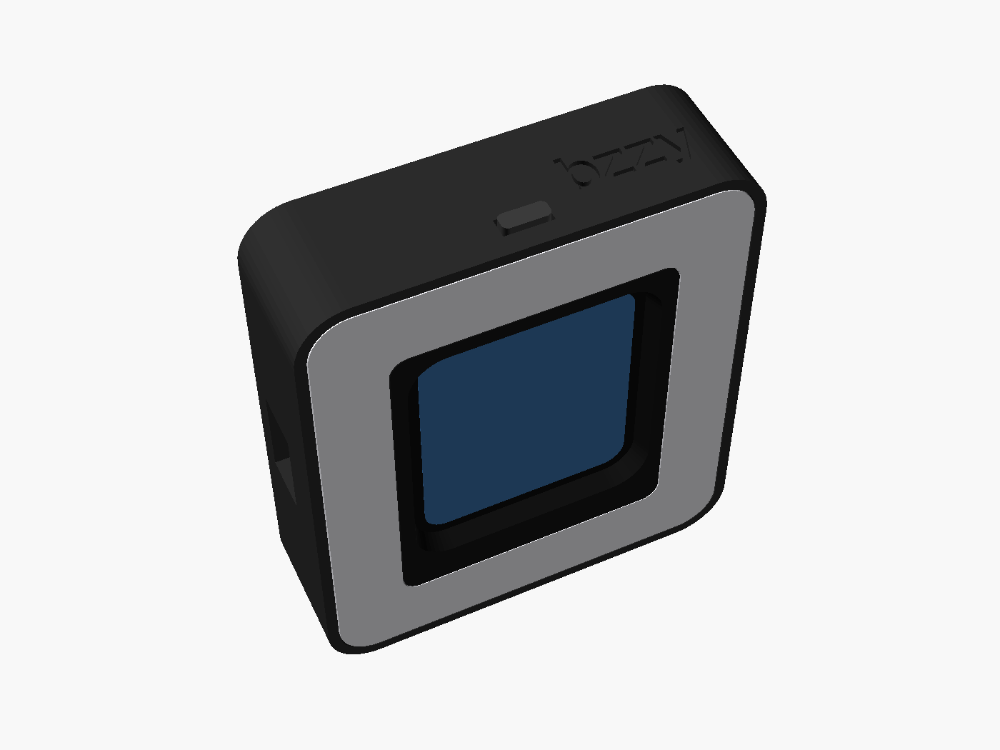
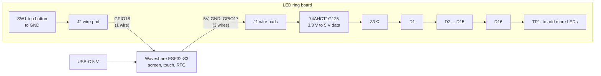
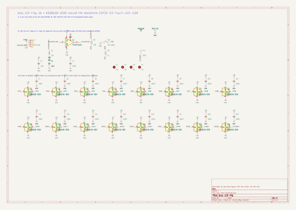

# bzzy hardware

bzzy hardware now runs on two tracks:

- **Main track: the bzzy main board** (being designed). One custom board with a certified ESP32-S3-WROOM-1U module, the bare 1.69" touch screen and the 16 LEDs. This is what built bzzys will be sold on, because the Waveshare board has no ISED radio certification and can't be sold inside one. Spec: [docs/hardware/main-board.md](../docs/hardware/main-board.md). Plan: [docs/plan.md](../docs/plan.md). Placement study: [main-board/](main-board/).
- **DIY side stream: Waveshare + LED ring board + printed case** (this page). For people building their own: buy a Waveshare board, order the ring board, get the case printed. It keeps the barrier to building one low, and work on it continues on the side.

> **Not built yet.** No LED ring board (rev B, B2 or C) has been ordered, built or tested. The files below passed KiCad's design-rule check and a design review, but treat them as unproven until someone builds one. Measure your Waveshare board first ([Before you order](#before-you-order)).

The DIY build is a frame of light around the screen. It has four parts:

1. The **Waveshare ESP32-S3-Touch-LCD-1.69**, the brains and the screen. It's unchanged from the prototype.
2. A custom **LED ring board** with 16 small RGB LEDs. It sits around the Waveshare board.
3. A printed **frosted white border**, about 1 cm wide, round the screen. The LEDs light it in the status colour.
4. A printed **black case** round all of it, with a button on top, the bzzy wordmark, and a monitor clip.

Nothing changes in the firmware. The ring board uses the same data pin (GPIO17) and LED count (16) that `firmware/src/config.h` already has.

This is **rev C, never built**. Rev C opens the bottom of the ring so a USB-C plug can reach the Waveshare socket (rev B added the button on top). The board has been through KiCad's design-rule check, but nobody has built or tested one yet. Measure the Waveshare board before you order anything (see [Before you order](#before-you-order)).

| Front | Busy (lit red) | Top: button and wordmark |
|---|---|---|
|  |  |  |
| **Back, with the clip** | **Exploded** | |
|  |  | |

## Plan

- **DIY side stream (rev C):** an LED ring board around the Waveshare board, with a button on top, plus a printed case. It's cheap and quick to get made, and fine for building your own. Next for it: measure a Waveshare board, then order and test a ring. Fixes from the rev C review (and a 250 mA LED cap) would go into a rev D once the measurements are in.
- **Main track:** the [bzzy main board](../docs/hardware/main-board.md), for built bzzys that are sold. It keeps this ring board's 52 × 61 mm outline, corner holes and LED positions, so the case works for both.

## How it fits together



## LED ring board

Files are in [led-ring/](led-ring/). Open `bzzy-led-ring.kicad_pro` in KiCad 7 or later.

| | |
|---|---|
| Size | 52 × 61 mm, 2 layers, 1.6 mm. The 34.2 × 42.7 mm cutout fits the Waveshare board. A 14 mm notch at the bottom middle opens the cutout to the edge, so the USB-C plug can pass through the ring. No copper within 2.7 mm of the M2 holes, so screw heads sit on bare board |
| LEDs | 16 × WS2812B-2020 (2 × 2 mm), every 10 to 12 mm, chained clockwise from just left of the notch |
| Data | GPIO17 (3.3 V), then a 74AHCT1G125 buffer to 5 V logic, then 33 Ω to the first LED. A 100 kΩ pull-down keeps the LEDs dark while the ESP32 boots |
| Power | 5 V from the Waveshare board's 5V pad. A 0.8 mm power ring on the back, a 100 nF cap per LED, and 2 × 10 µF bulk caps. Firmware caps the LEDs at 400 mA |
| Connection | J1 is three plated holes on the left side (5V, GND, IO17 from top to bottom, labelled on the back). J2 is one plated hole at the top, right of the button (IO18). Both are clear of the USB-C plug. Solder four short wires to the Waveshare board's 5V, GND, GPIO17 and GPIO18 pads |
| Top button | SW1, an Alps SKRT side-push switch on the top edge, with its plunger pointing up. You press it through a black button cap in the case's top wall. It shorts GPIO18 to GND, and the firmware turns on the internal pull-up |
| Mounting | 4 × M2 holes in the corners. The screws go through the case's back plate and the ring board into the light ring |
| Assembly | Every part is on the front, so JLCPCB assembles one side only. You hand-solder the J1 and J2 wires |



| Front (LEDs) | Back (+5V ring, GND pour) |
|---|---|
|  |  |

### How it's made

[`led-ring/gen_led_ring.py`](led-ring/gen_led_ring.py) is the source of truth. It writes these files:

- the KiCad schematic, with connectivity checked against the script's netlist
- the PCB, with parts placed, traces routed and ground poured
- `fab/bom-jlcpcb.csv` and `fab/cpl-jlcpcb.csv`, for JLCPCB assembly
- `fab/drc-report.txt`. Rev C: **0 violations, 0 unconnected pads**. The switch's own land pattern puts its pads closer to its peg holes than the board rule allows, so `bzzy-led-ring.kicad_dru` allows that within SW1 only
- `case/board_dims.scad`, so the case always matches the board

The ring is regular, so the script routes it by rule instead of with an autorouter. Each LED's 5 V pad drops through a via onto the power ring. Its ground pad joins the ground pour. Its data out runs straight to the next LED, and the corners go round the screen side of the mounting holes.

To change something, edit the script and run `./render.sh` (needs KiCad 7+ and OpenSCAD). Once the design settles, you can stop using the script and edit the board directly in KiCad.

### Bill of materials (per board)

| Ref | Qty | Part | Package | Notes |
|---|---|---|---|---|
| D1 to D16 | 16 | WS2812B-2020 | 2020 | Addressable RGB LED |
| U1 | 1 | 74AHCT1G125 | SOT-23-5 | Level shifter. A 74HCT1G125 works too |
| C1, C4 to C19 | 17 | 100 nF, X7R, 16 V | 0402 | |
| C2, C3 | 2 | 10 µF, X5R, 10 V+ | 0805 | |
| R1 | 1 | 100 kΩ | 0402 | |
| R2 | 1 | 33 Ω | 0402 | |
| SW1 | 1 | Alps SKRTLAE010 | SMD side-push | Top button |
| J1 | – | 3 plated holes, 2.54 mm | – | Wires, hand-soldered |
| J2 | – | 1 plated hole, 1.5 mm pad | – | Wire to GPIO18, hand-soldered |
| Screws | 4 | M2 × 8 self-tapping (or M2 × 8 with heat-set inserts in the light ring) | | |

`fab/bom-jlcpcb.csv` has an LCSC part number for every line (set in `gen_led_ring.py`). Check each match in JLCPCB's BOM step, and swap in a Basic part where one fits, since each Extended part adds a small fee. The WS2812B-2020, the 74AHCT1G125 and the SKRTLAE010 are probably Extended.

`fab/cpl-jlcpcb.csv` uses the same coordinates as the Gerbers, and its rotations already include JLCPCB's usual offsets (+180° for SOT-23-5, +90° for the WS2812B-2020). JLCPCB's own footprint decides the real orientation, so still check the preview.

**Rough cost:** about US$30 to $50 for 5 assembled boards before shipping and duty. That's an estimate, not a quote.

## Case

[`case/bzzy_case.scad`](case/bzzy_case.scad) is parametric OpenSCAD. The case is black, with the screen in the middle of a frosted white border about 1 cm wide (9.2 mm at the sides, 9.5 mm top and bottom). The LEDs sit under the border. Overall it's about 58 × 67 × 15 mm, plus the clip.

Looking at the front, from the middle out: the screen, a thin black trim over the Waveshare board's own glass edge, the frosted border, then a 1.4 mm black rim. The border starts at the Waveshare board's edge, not at the lit screen, because no LED can sit under the board. The ring board didn't need to change for this.

Export a part with:

```sh
openscad -D 'PART="light"' -o light.stl case/bzzy_case.scad   # or frame, back, trim, button, clip
```

`./render.sh` exports all six to `case/stl/`, each already turned the way it prints best. They aren't committed until the measurements are confirmed.

| Part | Colour and material | Notes |
|---|---|---|
| light | **Frosted white.** Translucent white PETG, or clear or white resin (SLA) with a matte finish | The glowing border. 1.6 mm thick at the front, about 2.4 mm in front of the LEDs. Its outer lip sits over the frame's rim, and four bosses take the screws. Print it face down |
| frame | **Black.** PLA, PETG, or MJF nylon (PA12, dyed black) | Front rim and the four side walls, with the USB-C opening and BOOT pinhole on the bottom, and the button hole and wordmark on top. Print it face down |
| back | **Black** | Back plate. Four posts press the ring board forward and the screws go through them. Dovetail rail for the clip |
| trim | **Black** | Sleeve round the Waveshare board, with the thin trim round the screen. Keeps LED light off the display. The light ring holds it down |
| button | **Black** | Cap for the top button. Sits in a pocket in the frame's top wall, held in by its flange. Print it flange down |
| clip | **Black.** PETG or nylon (needs some flex) | Slides up the rail. Two legs rest on the monitor's top edge, with a lip at the front and a drop at the back. Set `MONITOR_T` to your monitor's thickness |

**For a print service** (JLC3DP, Craftcloud, a local shop): order `light.stl` in translucent or white resin, and the other five in black. MJF nylon in black is tough and has no visible layers, which suits the frame and clip. Resin is fine for the light ring, but ask for the "translucent" or "semi-transparent" option with a matte or sanded finish, so the LEDs don't show as dots. None of the parts need supports in the orientation they're exported in, except the back plate, which stands on its rail. Ask the service to orient it, or use MJF or resin, where it doesn't matter.

### How it goes together

1. Put the button cap into its pocket in the frame's top wall, from the inside.
2. Hold the frame face up and drop the light ring in from the front, so its lip sits on the frame's rim. Turn the two over together, face down on the table.
3. Put the trim in from the back, face down, through the light ring's middle.
4. Put the ring board, LEDs down, onto the light ring's bosses, then the Waveshare board into the trim. The button cap now rests just off the switch.
5. Put a square of 3 mm foam tape on the back of the Waveshare board, then put the back plate on and do up the four M2 screws. They pull the light ring back, and its lip clamps the frame's rim against the back plate. No glue.
6. Slide the clip up the rail.

### The top button

The switch only travels 0.2 mm, and its plunger tip sits on the board's routed edge, which is only accurate to about ± 0.2 mm. So the cap rests 0.1 mm off the plunger and can float 0.5 mm outwards. A board that comes back slightly large pushes the cap out a little, instead of holding the switch down. If the switch were held down, the device would boot into setup every time. `TOP_BTN_Z` is the plunger's height above the board (0.8 mm for the Alps SKRT). Check it against the switch once you have one.

### The wordmark

"bzzy" is debossed 0.6 mm into the top face, right of the button, in Geist SemiBold, the font the app uses, with tight tracking. The font is in `case/fonts/` (SIL Open Font License). Set `LOGO` to move it:

| `LOGO` | Where |
|---|---|
| `"top"` (default) | Top face, right of the button. People standing at your desk see it |
| `"chin"` | Front, in a 9 mm black chin below the border. The device gets taller and the screen sits above centre |
| `"back"` | Back plate, above the clip rail. Hidden when the device is on the monitor |
| `"none"` | No wordmark |

## Before you order

Waveshare only publishes the board's outline as a drawing, which I couldn't read from here, so a few numbers are **estimates**. With calipers, measure:

1. **The Waveshare board's width, height and total thickness** (`WS_W`, `WS_H`, `WS_T` in `gen_led_ring.py`). The cutout and case follow from these. I used 33.0 × 41.5 × 9.5 mm.
2. **Where the screen sits**: the visible area's size, and whether it's centred on the board (`SCREEN_*`, `SCREEN_DY` in the case).
3. **The glass height**: when the Waveshare board sits in the ring's cutout, how far its glass stands proud of the ring board's front face (`GLASS_Z`).
4. **USB-C and BOOT button positions** (`USB_*`, `BOOT_*`). I assumed the USB-C socket is on the bottom edge, in the middle. The rev C ring board has a 14 mm notch at the bottom middle for the plug. Check that your cable's plug moulding (12 × 6.5 mm assumed) fits through it.
5. **Your monitor's top edge thickness** (`MONITOR_T`).

Then print the frame, light ring and back once in cheap PLA to check the fit before ordering boards.

## Ordering from JLCPCB

1. Run `./render.sh`, which writes `led-ring/fab/gerbers.zip`. Or, in KiCad, export Gerbers and drill files (File, Fabrication Outputs) with JLCPCB's KiCad settings, and zip the folder.
2. Upload the zip at jlcpcb.com. Defaults are fine: 2 layers, 1.6 mm, HASL lead-free or ENIG, any colour. Black or white looks best behind a translucent frame.
3. Turn on **PCB Assembly**, top side, and upload `fab/bom-jlcpcb.csv` and `fab/cpl-jlcpcb.csv`.
4. In the parts-matching step, confirm the LCSC part on each line. In the placement preview, **check every LED, U1 and SW1**: the pin 1 dot should match the KiCad drawing. U1 matters most: placed backwards, it gets 5 V on its GND pin. Fix any rotation in the preview if needed.

## The main board

The custom board that used to be called "v2" is now the main track: one board with an ESP32-S3-WROOM-1U module, the bare screen, USB-C, a clock and the LEDs. Its full spec, including the certification path, is [docs/hardware/main-board.md](../docs/hardware/main-board.md).

## Open questions

- Are 16 LEDs enough? Firmware handles more, and TP1 lets you chain extras.
