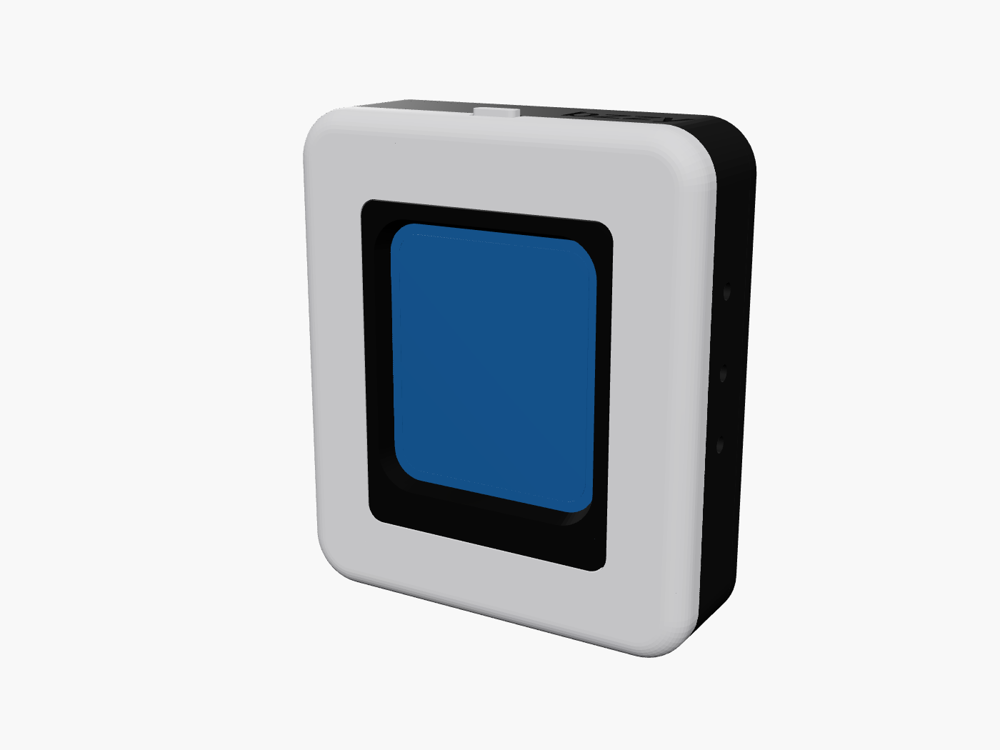
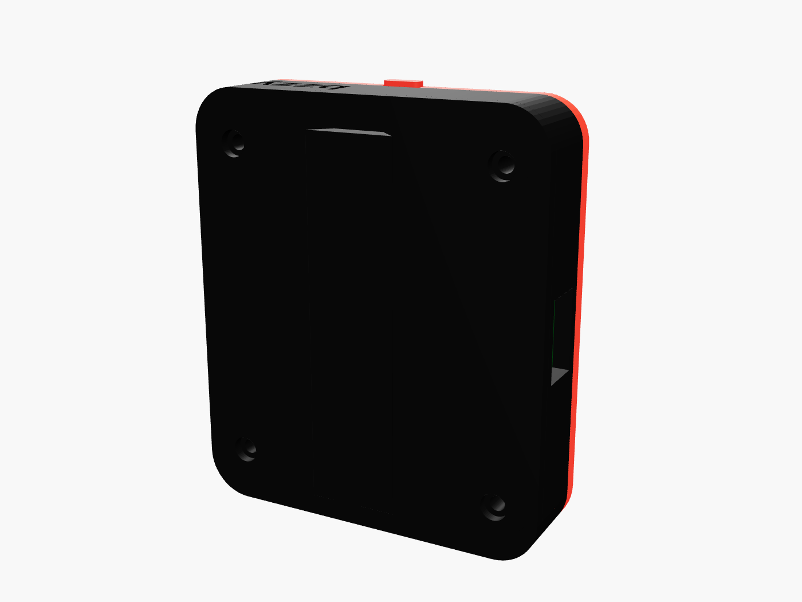

# bzzy hardware

> **2026-11-19: bzzy is moving to one custom board.** The sellable bzzy is built on the **main board**: an ESP32-S3-WROOM-1U module (certified radio, small stuck-on antenna), the bare 1.69" 240 × 280 touch screen (BuyDisplay ER-TFT1.69-4), USB-C, a clock and the 16-LED ring, all on one PCB. The Waveshare ESP32-S3-Touch-LCD-1.69 has no ISED certification, so it can't be sold inside bzzy; it stays as the **development board**. The separate LED ring board (rev B to C) was never ordered and is [archived](archive/README.md).
>
> The full spec is [docs/hardware/main-board.md](../docs/hardware/main-board.md). The step-by-step plan is [docs/plan.md](../docs/plan.md).

The device is a frame of light around a screen:

1. The **main board** (rev A, being designed): the brains, the screen and the ring of 16 RGB LEDs on one board, 52 × 61 mm for the prototypes.
2. A printed **frosted white border**, about 1 cm wide, round the screen. The LEDs light it in the status colour.
3. A printed **black case** round all of it, with a button on top, the bzzy wordmark, and a monitor clip.

The firmware barely changes: the main board keeps the Waveshare board's pins (LED data on GPIO17, top button on GPIO18), so it only needs a new PlatformIO env.

| Front | Busy (lit red) | Top: button and wordmark |
|---|---|---|
|  |  |  |
| **Back, with the clip** | **Exploded** | |
|  |  | |

Renders of the current case, round the Waveshare board and the rev C ring.

## What's here

| Folder | What it is | Status |
|---|---|---|
| [main-board/](main-board/) | Placement study for the main board (`placement.py` draws `placement.svg`). KiCad files go here next | Spec agreed, schematic not started |
| [case/](case/) | The OpenSCAD case | Designed for the Waveshare + ring; redesign due |
| [archive/](archive/README.md) | The LED ring board (rev C) and its generator | Archived, never ordered |
| `render.sh` | Regenerates the case renders and STLs, and the archived ring board's files and `case/board_dims.scad` | Needs KiCad 7+ and OpenSCAD |

## Boards

| Board | Use | Docs |
|---|---|---|
| **bzzy main board, rev A** | The product. Being designed | [main-board.md](../docs/hardware/main-board.md) |
| ESP32-S3 DevKitC + ER-TFT1.69-4 on a breakout | Bench test of the main board's screen and pins, before the PCB | [s3-devkit-bench-test.md](../docs/s3-devkit-bench-test.md) |
| Waveshare ESP32-S3-Touch-LCD-1.69 | Development board. Same chip, memory and pins as the main board | [README](../README.md#hardware) |
| Waveshare ESP32-C6-LCD-1.47, a classic ESP32 + 16x2 LCD | Cheap test builds | [esp32-c6-test-build.md](../docs/esp32-c6-test-build.md), [esp32-test-build.md](../docs/esp32-test-build.md) |
| LED ring board, rev C | Was going to sit round the Waveshare board | [archived](archive/led-ring-revC/README.md) |

## Plan

See [docs/plan.md](../docs/plan.md). In short: test the Waveshare board and the ER-TFT1.69-4 panel on the bench, then draw the main board in KiCad and redesign the case, order 5 to 10 prototypes from JLCPCB, get the ICES-003 emissions test done, then build the first batch.

## Case

> The case below was designed round the Waveshare board and the rev C ring board. The main board keeps the same 52 × 61 mm outline and corner holes, so this design is the starting point, but it gets reworked in step 3 of the [plan](../docs/plan.md): no Waveshare pocket, a thinner back, a pad and cable channel for the antenna, a label area, and maybe a smaller size (about 40 × 47 mm, [main board spec 7.3](../docs/hardware/main-board.md#73-how-small-could-it-get)). See [main board spec section 12](../docs/hardware/main-board.md#12-case-impact).

[`case/bzzy_case.scad`](case/bzzy_case.scad) is parametric OpenSCAD. The case is black, with the screen in the middle of a frosted white border about 1 cm wide (9.2 mm at the sides, 9.5 mm top and bottom). The LEDs sit under the border. Overall it's about 58 × 67 × 15 mm, plus the clip.

Looking at the front, from the middle out: the screen, a thin black trim over the Waveshare board's own glass edge, the frosted border, then a 1.4 mm black rim. The border starts at the Waveshare board's edge, not at the lit screen, because no LED can sit under the board. The ring board didn't need to change for this.

Export a part with:

```sh
openscad -D 'PART="light"' -o light.stl case/bzzy_case.scad   # or frame, back, trim, button, clip
```

`./render.sh` exports all six to `case/stl/`, each already turned the way it prints best. They aren't committed. A set exported 2026-11-12 is in the project files under `case-black/`.

| Part | Colour and material | Notes |
|---|---|---|
| light | **Frosted white.** Translucent white PETG, or clear or white resin (SLA) with a matte finish | The glowing border. 1.6 mm thick at the front, about 2.4 mm in front of the LEDs. Its outer lip sits over the frame's rim, and four bosses take the screws. Print it face down |
| frame | **Black.** PLA, PETG, or MJF nylon (PA12, dyed black) | Front rim and the four side walls, with the USB-C opening and BOOT pinhole on the bottom, and the button hole and wordmark on top. Print it face down |
| back | **Black** | Back plate. Four posts press the ring board forward and the screws go through them. Dovetail rail for the clip |
| trim | **Black** | Sleeve round the Waveshare board, with the thin trim round the screen. Keeps LED light off the display. The light ring holds it down |
| button | **Black** | Cap for the top button. Sits in a pocket in the frame's top wall, held in by its flange. Print it flange down |
| clip | **Black.** PETG or nylon (needs some flex) | Slides up the rail. Two legs rest on the monitor's top edge, with a lip at the front and a drop at the back. Set `MONITOR_T` to your monitor's thickness |

**For a print service** (JLC3DP, Craftcloud, a local shop): order `light.stl` in translucent or white resin, and the other five in black. MJF nylon in black is tough and has no visible layers, which suits the frame and clip. Resin is fine for the light ring, but ask for the "translucent" or "semi-transparent" option with a matte or sanded finish, so the LEDs don't show as dots. None of the parts need supports in the orientation they're exported in, except the back plate, which stands on its rail. Ask the service to orient it, or use MJF or resin, where it doesn't matter.

### How it goes together

1. Put the button cap into its pocket in the frame's top wall, from the inside.
2. Hold the frame face up and drop the light ring in from the front, so its lip sits on the frame's rim. Turn the two over together, face down on the table.
3. Put the trim in from the back, face down, through the light ring's middle.
4. Put the ring board, LEDs down, onto the light ring's bosses, then the Waveshare board into the trim. The button cap now rests just off the switch.
5. Put a square of 3 mm foam tape on the back of the Waveshare board, then put the back plate on and do up the four M2 screws. They pull the light ring back, and its lip clamps the frame's rim against the back plate. No glue.
6. Slide the clip up the rail.

### The top button

The switch only travels 0.2 mm, and its plunger tip sits on the board's routed edge, which is only accurate to about ± 0.2 mm. So the cap rests 0.1 mm off the plunger and can float 0.5 mm outwards. A board that comes back slightly large pushes the cap out a little, instead of holding the switch down. If the switch were held down, the device would boot into setup every time. `TOP_BTN_Z` is the plunger's height above the board (0.8 mm for the Alps SKRT). Check it against the switch once you have one.

### The wordmark

"bzzy" is debossed 0.6 mm into the top face, right of the button, in Geist SemiBold, the font the app uses, with tight tracking. The font is in `case/fonts/` (SIL Open Font License). Set `LOGO` to move it:

| `LOGO` | Where |
|---|---|
| `"top"` (default) | Top face, right of the button. People standing at your desk see it |
| `"chin"` | Front, in a 9 mm black chin below the border. The device gets taller and the screen sits above centre |
| `"back"` | Back plate, above the clip rail. Hidden when the device is on the monitor |
| `"none"` | No wordmark |

## Measuring the Waveshare board

The Waveshare board is now the development board, not part of the product, but the case still takes its numbers from it, and its glass is the closest thing to the main board's panel until the ER-TFT1.69-4 samples arrive. A few numbers are **estimates**. With calipers, measure:

1. **The Waveshare board's width, height and total thickness** (`WS_W`, `WS_H`, `WS_T` in `archive/led-ring-revC/gen_led_ring.py`). The cutout and case follow from these. I used 33.0 × 41.5 × 9.5 mm.
2. **Where the screen sits**: the visible area's size, and whether it's centred on the board (`SCREEN_*`, `SCREEN_DY` in the case).
3. **The glass height**: when the Waveshare board sits in the ring's cutout, how far its glass stands proud of the ring board's front face (`GLASS_Z`).
4. **USB-C and BOOT button positions** (`USB_*`, `BOOT_*`). I assumed the USB-C socket is on the bottom edge, in the middle. The main board puts its own USB-C socket in the same place.
5. **Your monitor's top edge thickness** (`MONITOR_T`).

For the main board, the screen numbers come from the ER-TFT1.69-4 datasheet (33.13 × 41.13 mm cover glass, 3.85 mm thick with touch) and get checked with calipers on the samples ([bench test](../docs/s3-devkit-bench-test.md)).

## Open questions

The main board's open questions (clock backup, BOOT and RESET switches, antenna position, final size and so on) are in [main board spec section 14](../docs/hardware/main-board.md#14-open-questions).
