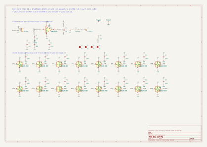
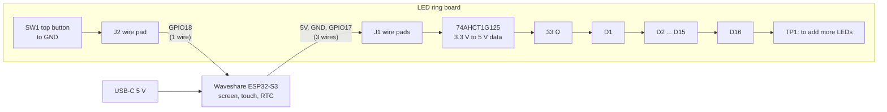

# LED ring board, rev C (archived)

> **Archived 2026-11-19. Don't order this board.** bzzy moved to one merged custom board, the [main board](../../../docs/hardware/main-board.md): an ESP32-S3-WROOM-1U module, the bare 1.69" screen and the 16 LEDs on a single PCB. The Waveshare ESP32-S3-Touch-LCD-1.69 this ring was built around has no ISED certification, so it can't be sold inside bzzy; it stays as a development board. See [docs/plan.md](../../../docs/plan.md).
>
> No ring board (rev B, B2 or C) was ever ordered, and the planned rev D was dropped. What carries over to the main board: the 52 × 61 mm outline and corner holes, the 16 LED positions, the level shifter and button circuit, the rev C review findings, and the 250 mA LED cap planned for rev D.
>
> This folder is kept because `gen_led_ring.py` still writes `hardware/case/board_dims.scad` (the case reads it) and holds the LED coordinates the main board reuses. Gerbers, BOMs and the rev C review from the design threads are in the project files under `hardware/archive/led-ring/`.

The ring board sat round the Waveshare board, with 16 small RGB LEDs lighting a frosted border, and a button on top. Rev C opened the bottom of the ring so a USB-C plug could reach the Waveshare socket (rev B added the button on top). It passed KiCad's design-rule check, but nobody built one.

| Front (LEDs) | Back (+5V ring, GND pour) |
|---|---|
|  |  |

## How it fits together

## LED ring board

The files are in this folder. Open `bzzy-led-ring.kicad_pro` in KiCad 7 or later.

| | |
|---|---|
| Size | 52 × 61 mm, 2 layers, 1.6 mm. The 34.2 × 42.7 mm cutout fits the Waveshare board. A 14 mm notch at the bottom middle opens the cutout to the edge, so the USB-C plug can pass through the ring. No copper within 2.7 mm of the M2 holes, so screw heads sit on bare board |
| LEDs | 16 × WS2812B-2020 (2 × 2 mm), every 10 to 12 mm, chained clockwise from just left of the notch |
| Data | GPIO17 (3.3 V), then a 74AHCT1G125 buffer to 5 V logic, then 33 Ω to the first LED. A 100 kΩ pull-down keeps the LEDs dark while the ESP32 boots |
| Power | 5 V from the Waveshare board's 5V pad. A 0.8 mm power ring on the back, a 100 nF cap per LED, and 2 × 10 µF bulk caps. Firmware caps the LEDs at 400 mA |
| Connection | J1 is three plated holes on the left side (5V, GND, IO17 from top to bottom, labelled on the back). J2 is one plated hole at the top, right of the button (IO18). Both are clear of the USB-C plug. Solder four short wires to the Waveshare board's 5V, GND, GPIO17 and GPIO18 pads |
| Top button | SW1, an Alps SKRT side-push switch on the top edge, with its plunger pointing up. You press it through a black button cap in the case's top wall. It shorts GPIO18 to GND, and the firmware turns on the internal pull-up |
| Mounting | 4 × M2 holes in the corners. The screws go through the case's back plate and the ring board into the light ring |
| Assembly | Every part is on the front, so JLCPCB assembles one side only. You hand-solder the J1 and J2 wires |

### How it's made

[`gen_led_ring.py`](gen_led_ring.py) is the source of truth. It writes these files:

- the KiCad schematic, with connectivity checked against the script's netlist
- the PCB, with parts placed, traces routed and ground poured
- `fab/bom-jlcpcb.csv` and `fab/cpl-jlcpcb.csv`, for JLCPCB assembly
- `fab/drc-report.txt`. Rev C: **0 violations, 0 unconnected pads**. The switch's own land pattern puts its pads closer to its peg holes than the board rule allows, so `bzzy-led-ring.kicad_dru` allows that within SW1 only
- `../../case/board_dims.scad`, so the case always matches the board (the case still uses it)

The ring is regular, so the script routes it by rule instead of with an autorouter. Each LED's 5 V pad drops through a via onto the power ring. Its ground pad joins the ground pour. Its data out runs straight to the next LED, and the corners go round the screen side of the mounting holes.

To change something, edit the script and run `hardware/render.sh` (needs KiCad 7+ and OpenSCAD). Once the design settles, you can stop using the script and edit the board directly in KiCad.

### Bill of materials (per board)

| Ref | Qty | Part | Package | Notes |
|---|---|---|---|---|
| D1 to D16 | 16 | WS2812B-2020 | 2020 | Addressable RGB LED |
| U1 | 1 | 74AHCT1G125 | SOT-23-5 | Level shifter. A 74HCT1G125 works too |
| C1, C4 to C19 | 17 | 100 nF, X7R, 16 V | 0402 | |
| C2, C3 | 2 | 10 µF, X5R, 10 V+ | 0805 | |
| R1 | 1 | 100 kΩ | 0402 | |
| R2 | 1 | 33 Ω | 0402 | |
| SW1 | 1 | Alps SKRTLAE010 | SMD side-push | Top button |
| J1 | – | 3 plated holes, 2.54 mm | – | Wires, hand-soldered |
| J2 | – | 1 plated hole, 1.5 mm pad | – | Wire to GPIO18, hand-soldered |
| Screws | 4 | M2 × 8 self-tapping (or M2 × 8 with heat-set inserts in the light ring) | | |

`fab/bom-jlcpcb.csv` has an LCSC part number for every line (set in `gen_led_ring.py`). Check each match in JLCPCB's BOM step, and swap in a Basic part where one fits, since each Extended part adds a small fee. The WS2812B-2020, the 74AHCT1G125 and the SKRTLAE010 are probably Extended.

`fab/cpl-jlcpcb.csv` uses the same coordinates as the Gerbers, and its rotations already include JLCPCB's usual offsets (+180° for SOT-23-5, +90° for the WS2812B-2020). JLCPCB's own footprint decides the real orientation, so still check the preview.

**Rough cost:** about US$30 to $50 for 5 assembled boards before shipping and duty. That's an estimate, not a quote.

## Ordering from JLCPCB

1. Run `hardware/render.sh`, which writes `fab/gerbers.zip` here. Or, in KiCad, export Gerbers and drill files (File, Fabrication Outputs) with JLCPCB's KiCad settings, and zip the folder.
2. Upload the zip at jlcpcb.com. Defaults are fine: 2 layers, 1.6 mm, HASL lead-free or ENIG, any colour. Black or white looks best behind a translucent frame.
3. Turn on **PCB Assembly**, top side, and upload `fab/bom-jlcpcb.csv` and `fab/cpl-jlcpcb.csv`.
4. In the parts-matching step, confirm the LCSC part on each line. In the placement preview, **check every LED, U1 and SW1**: the pin 1 dot should match the KiCad drawing. U1 matters most: placed backwards, it gets 5 V on its GND pin. Fix any rotation in the preview if needed.

## The original "v2" notes

These are notes for later, once the ring board has proven the case and the light.

**Update 2026-11-19:** the Waveshare board has no ISED certification, so it can't be sold inside bzzy. The full spec for the custom board (one board with the ring merged in, built on a certified Espressif module) is in [docs/hardware/main-board.md](../../../docs/hardware/main-board.md).

- **MCU:** an ESP32-S3-WROOM-1-N16R8 module. It has the same 16 MB flash and 8 MB PSRAM as the Waveshare board, plus a certified antenna. Keep the module's antenna end at the top edge, with no copper or LEDs under it.
- **Screen:** the bare 1.69" 240 × 280 ST7789V2 panel with CST816T touch on an FPC connector. Waveshare sells the panel separately as the "1.69inch Touch LCD Module". Find the panel's FPC pinout before laying out.
- **Pins:** keep the Waveshare mapping (LCD 4 to 8 and 15, I2C 10 and 11, touch 13 and 14, LEDs 17, top button 18, BOOT 0). The firmware then only needs a new PlatformIO env, or none at all.
- **Power:** USB-C into the S3's native USB (GPIO19 and 20), with 5.1 kΩ CC resistors, ESD protection and a fuse. A 3.3 V LDO rated 1 A for the S3's Wi-Fi peaks, and the LEDs straight off 5 V.
- **Keep:** PCF85063 RTC with a coin cell or supercap, and the BOOT and RESET buttons.
- **Drop:** the IMU, buzzer and Li-ion charger, unless there's a reason to keep them.
- **Result:** one board, roughly the ring board's size. That makes the case thinner and the build simpler, with no wires between boards.
